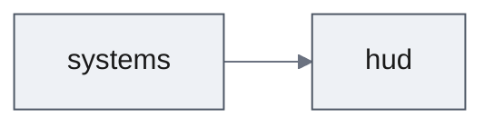

# Feature Spec: [Feature Name]

<!--
Depth: `full` | `lite` — set by scale. Sections marked *(full depth)* are omitted in a lite spec; every other section is present at both depths. A feature spec is written for every feature at every scale: it is where acceptance criteria and Delivery Parts live.
Follow `documentation-criteria`, "Writing for the Reader": header and Snapshot first, current truth only, Update History last, delete what does not apply.
-->

**Status**: Draft | In review | Approved · **Date**: YYYY-MM-DD · **Engine**: [Phaser 3 / Godot / Unity / Unreal] · **Depth**: full | lite · **GDD**: [path]

## Snapshot

<!-- At most ten lines. -->

**Overview.** [three to five plain sentences — what the player is missing today, what the feature gives them, and how it plays, told to a colleague who has not seen the GDD]

- **Does not change**: [the one or two things a reader would otherwise assume change]
- **Parts**: [part names]
- **Priority**: [High / Medium / Low] — [one-phrase reason]
- **Biggest risk**: [one phrase]
- **Open questions**: [a link to Open Questions, or "none"]

## Market Justification *(full depth)*

**Player Demand**: [Evidence this feature is wanted]
**Competitive Analysis**: [How competitors handle this feature]
**Market Impact**: [Expected effect on player engagement/retention]

## Problem Statement
[What problem does this feature solve? What player need does it address?]

## User Stories
- **As a [player type]**, I want **[action/capability]** so that **[benefit/value]**
- **As a [player type]**, I want **[action/capability]** so that **[benefit/value]**

## Acceptance Criteria
<!-- Each criterion is one testable statement with one outcome. An outcome that is not decided yet cites its open question (OQ-n) and states nothing else. -->
### Must Have
- **AC-1**: [Specific, testable requirement]
- **AC-2**: [Specific, testable requirement]

### Should Have
- **AC-3**: [Nice-to-have requirement]

### Could Have
- **AC-4**: [Optional enhancement]

## Delivery Parts

Parts split the feature into independently designable slices. Each part receives its own Design Doc (`design-{part}.md`) and its own work plans, designed and built in the dependency order below. The split is proposed here from `requirement-analyzer`'s `parts[]` and confirmed by the user at Feature Spec approval; criteria are in the `documentation-criteria` skill, "Parts and plans".

| Part | Covers | Cut along | Depends on | Rationale |
|------|--------|-----------|------------|-----------|
| `[part-name]` | [AC-1, AC-3] | [one key: `engine-systems`, `ui`, `hud`, `menu`, `domain`, `release-unit`] | — | [Why this is a separate slice, one sentence] |
| `[part-name]` | [AC-2] | [...] | `[part-name]` | [...] |

**Coverage**: every Must Have acceptance criterion above appears in exactly one row. Should Have and Could Have items appear in a row or are deferred here:

- Deferred: [item assigned to no part, with reason]

**Single part**: when the whole feature is one slice, write one row and say why in its rationale. One part is the common case.

### Part Dependency Diagram

[When applicable: three or more parts (with two, the Depends on column already says it). An arrow points from a part to the part whose approved design it consumes.]

## Functional Requirements *(full depth)*
### Input Specifications
- **Input Method**: [Keyboard, mouse, controller, touch]
- **Input Triggers**: [Specific keys/buttons]
- **Input Behavior**: [Press, hold, release, gesture]

### Output Specifications
- **Visual Feedback**: [What the player sees]
- **Audio Feedback**: [What the player hears]
- **Haptic Feedback**: [Controller vibration — delete when not applicable]

### State Management
- **Initial State**: [How the feature starts]
- **Active States**: [Different modes or conditions]
- **Transition Conditions**: [What triggers state changes]

## Technical Requirements
### Performance Constraints *(full depth)*
<!-- Targets only. They are checked by on-demand profiling on the target platform, not by tests in the regular suite. -->
- **Frame budget**: [e.g., 60 fps on the target platform]
- **Memory ceiling**: [MB]
- **Rendering cost**: [draw call or GPU budget]

### Game Data
[The game data this feature reads or writes, in words — schemas and structures belong to the Design Doc]

### Integration Points
- **Systems Used**: [Which existing systems this connects to]
- **Events Triggered**: [Signals or events this feature generates]
- **Events Consumed**: [Signals or events this feature responds to]

## Balancing Parameters *(full depth)*
<!-- This spec owns these values; the Design Doc and code cite them by name. -->
### Tunable Values

| Parameter | Value | Range | What it tunes |
|---|---|---|---|
| [name] | [value] | [min–max] | [what the player feels when it changes] |

### Balancing Goals
[What we're trying to achieve with these parameters]

## Edge Cases & Error Handling *(full depth)*
### Edge Cases
- **[Scenario]**: [How the system should respond]

### Error Conditions
- **[Error Type]**: [Prevention/Recovery strategy]

## User Experience Considerations *(full depth)*
### Accessibility
- [How this feature supports different player abilities]

### Learning Curve
- [How players discover and master this feature]

### Player Feedback
- [How players know the feature is working]

## Analytics Integration *(full depth)*
### Telemetry Events
- **Feature Activation**: [When/how to track usage]
- **Player Actions**: [Specific interactions to measure]
- **Performance Impact**: [System metrics to monitor]

### A/B Testing Framework
<!-- Delete when no experiment is planned. -->
- **Test Variants**: [Different versions to test]
- **Success Metrics**: [How to measure which version wins]
- **Sample Size**: [How many players needed for significance]
- **Duration**: [How long to run the test]

## Engine Constraints *(full depth)*
<!-- Constraints the engine or platform imposes on this feature. The implementation approach is designed in the Design Doc. -->
- **[Constraint]**: [What it rules out or requires]

## Player Verification *(full depth)*
<!-- What playtests must show. Automated tests are planned from the Design Doc under `testing-principles`, Test Selection — they are not listed here. -->
- [Usability or fun check, and the AC it confirms]

## Risks *(full depth)*
- **[Risk]**: [Mitigation strategy]

## Open Questions
<!-- Delete the section when none are open. -->
- **OQ-1**: [Question] — [who decides, what it blocks]

## Update History

<!-- One line per version, newest last, a phrase per change. No reviewer IDs. -->

| Version | Date | Change |
|---|---|---|
| 1.0 | YYYY-MM-DD | Initial version |
