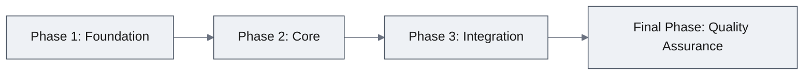
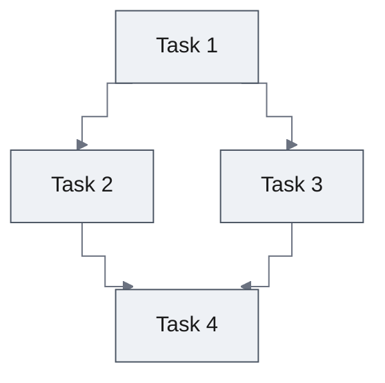

<!--
Reader order: header → Snapshot → how the work runs (diagrams, phases, verification, risks) → Appendix: Traceability → Update History.
The user reads this plan at batch approval; every section follows "Writing for the Reader" in documentation-criteria.
Frontmatter is the source of truth for plan sequencing: `plan: N of M` states how many plans the part is expected to need, `status` marks which one runs now,
`depends-on` fixes the order without relying on filename sort. Exactly one plan per part may be `active`; raise `M` rather than adding an unannounced plan file.
Text inside these comments is guidance for the author; it is not copied into the document.
-->

# Work Plan: [Feature Name] — [part-name]

Created Date: YYYY-MM-DD
Type: feature|fix|refactor
Estimated Duration: X days
Estimated Impact: X files
Related Issue/PR: #XXX (if any)

## Snapshot

<!-- At most ten lines. A reader who stops here knows what gets built, in what order, and what could go wrong. The why of the feature is the PRD's and the design's; cite them, don't retell them. -->

**Overview.** [Three to five plain sentences: what this plan builds, in what order, and why that order.]

- **Does not change**: [what a reader would otherwise assume this plan touches]
- **Biggest risk**: [one line, and the task that meets it first]
- **Open questions**: [each question and who resolves it, or "none"]

## Related Documents
- PRD: [docs/features/{feature}/prd.md]
- Design Doc: [docs/features/{feature}/design-{part}.md] (none at small scale)
- ADR: [docs/adr/ADR-XXXX.md] (if any)
- UXRD: [docs/features/{feature}/uxrd.md] (if any)

## Phase Structure Diagram

## Task Dependency Diagram

## Implementation Phases

<!-- Phases follow the Design Doc's technical dependencies and Implementation Approach. Repeat the phase block per phase; the final phase is always Quality Assurance.
A task opens with one line saying, in words, what it delivers; Target Files, dependencies, and the tests it adds (by title, with what each proves) are sub-bullets. -->

### Phase 1: [Phase Name] (Estimated commits: X)
**Purpose**: [what this phase delivers, in one or two sentences]

#### Tasks
- [ ] Task 1: [what it delivers]
- [ ] Task 2: [what it delivers]
- [ ] Quality check: staged quality checks (`ai-development-guide`)
- [ ] Unit tests: all related tests pass

#### Phase Completion Criteria
- [ ] [Functional completion criteria]
- [ ] [Quality completion criteria]

#### Operational Verification Procedures
1. [Operation verification steps — for the integration points this phase completes (Design Doc, Integration Points List)]
2. [Expected result verification]
3. [Performance verification (when applicable)]

### Final Phase: Quality Assurance (Required) (Estimated commits: 1)
**Purpose**: Overall quality assurance and Design Doc consistency verification

#### Tasks
- [ ] Verify all Design Doc acceptance criteria achieved
- [ ] Quality checks (types, lint, format)
- [ ] Execute all tests
- [ ] Test set within the part budget (`testing-principles`, Test Selection); no two tests catch the same defect
- [ ] Document updates

#### Operational Verification Procedures
[End-to-end verification steps for the part's journeys]

## Verification Strategy (from Design Doc)

<!-- The design owns the correctness definition and the early verification point; cite them by section, don't copy them. This plan owns where they land. -->

- **Correctness definition and method**: `design-{part}.md`, Verification Strategy
- **Early verification point**: [the design's first verification target, in a few words] — run by [Phase X Task Y]
- **Proof obligations**: from test skeleton annotations (primary failure mode, proof obligation) when skeletons exist; otherwise each AC's primary failure mode, plus every applicable Failure Mode Checklist category. Each task that implements a claim records its Proof Obligations (task template), so review can judge whether the tests *prove* the claim rather than merely run

## Risks and Countermeasures

### Technical Risks
- **Risk**: [Risk description]
  - **Impact**: [Impact assessment]
  - **Countermeasure**: [How to address it]

### Schedule Risks
- **Risk**: [Risk description]
  - **Impact**: [Impact assessment]
  - **Countermeasure**: [How to address it]

## Completion Criteria
- [ ] All phases completed
- [ ] Each phase's operational verification procedures executed
- [ ] Design Doc acceptance criteria satisfied
- [ ] Staged quality checks completed (zero errors)
- [ ] All tests pass
- [ ] Necessary documentation updated
- [ ] User review approval obtained

## Notes

<!-- When applicable: anything the executor must know that no section above holds. -->

## Appendix: Traceability

<!-- The record that the plan covers the design: the reviewer and the executors check it, the reader reaches it by link. A subsection marked "when applicable" is deleted when it does not apply. -->

### Quality Assurance Mechanisms (from Design Doc)

Adopted quality gates for the change area. Each task in this plan must satisfy these mechanisms.

| Mechanism | Enforces | Config/Source | Covered Files | Type |
|-----------|----------|---------------|---------------|------|
| [Tool/check name] | [What quality aspect it enforces] | [path/to/config] | [literal paths, directory prefixes, or "project-wide"] | executable_check |
| [Domain constraint] | [What it enforces] | [path/to/source] | [literal paths, directory prefixes, or "project-wide"] | passive_constraint |

### Design-to-Plan Traceability

Maps each Design Doc technical requirement to its covering task(s). One row per extracted item. Every row needs at least one covering task **or** an explicit gap justification — an item that appears in neither is how a requirement silently disappears between design and implementation.

| Design Doc | DD Section | DD Item | Category | Covered By Task(s) | Gap Status | Notes |
|---|---|---|---|---|---|---|
| [docs/features/{feature}/design-{part}.md] | [Section name] | [Specific item] | impl-target / connection-switching / contract-change / verification / prerequisite | [Phase X Task Y] | covered | |
| docs/features/{feature}/design-{part}.md | Security Considerations | Input validation for API | prerequisite | — | gap | Deferred to Phase 2 |

**Category values**: `impl-target` (implementation target), `connection-switching` (connection/switching/registration), `contract-change` (contract change and propagation), `verification` (verification requirement), `prerequisite` (prerequisite work)

**Gap Status values**: `covered` (task exists), `gap` (no task — requires justification in Notes and user confirmation before plan approval)

### Reference Contract Values

<!-- When applicable: the Design Doc specifies a binding observable value the implementation must reproduce exactly — a column/label set and its order, a derived-display rule, or a state-lifecycle negative. Extract it from the Design Doc directly, not from the Traceability table's summarized DD Item. Serialized boundaries belong to the Connection Map; ADR-derived structural decisions to ADR Bindings. -->

The Traceability table records *that* a row is covered; this table carries the value **verbatim**, so the covering task is checked against the exact contract rather than a re-derived summary.

| Design Doc (§ Section) | Contract Type | Required Observable Value (verbatim) | Covered By Task(s) |
|---|---|---|---|
| [docs/features/{feature}/design-{part}.md (§ Section)] | structure-order / derived-display / state-lifecycle-negative | [exact value copied from the Design Doc — e.g. "the listed fields in the specified order"; "the label shows the looked-up name in place of the raw code"; "persisted state is applied only when an explicit restore signal is present"] | [Phase X Task Y] |

### Failure Mode Checklist

Domain-independent failure categories this implementation must guard against. Enumerate all nine, mark each yes/no, and list a covering task for each that applies. Keep entries free of project-specific names — these categories are what test suites most often omit precisely because they are unglamorous.

| Category | Applies? | Covered By Task(s) |
|---|---|---|
| same-value | yes/no | [Phase X Task Y] |
| no-op | yes/no | |
| empty input | yes/no | |
| invalid option | yes/no | |
| missing config | yes/no | |
| unavailable boundary | yes/no | |
| shared-state dependency | yes/no | |
| rollback-only visibility | yes/no | |
| missing-sort-key ordering | yes/no | |

### UXRD Component → Task Mapping

<!-- When applicable: a UXRD is among the inputs. Downstream steps read this table to populate each task's Investigation Targets with the corresponding UXRD section. -->

| UXRD Component (section heading) | States to Cover | Covered By Task(s) | Gap Status | Notes |
|---|---|---|---|---|
| [UXRD heading exactly as written, e.g. "§ Component: AlertCard"] | [default / loading / empty / error / partial] | [Phase X Task Y] | covered | |

**Reference key rule**: column 1 is the UXRD section heading verbatim. Headings are unique, so the reference resolves to exactly one section.

**Gap Status values**: `covered`, `gap` (requires justification in Notes and user confirmation before plan approval)

### ADR Bindings

<!-- When applicable: ADRs are provided as input or listed in the Design Doc's Prerequisite ADRs. -->

A decision is **implementation-binding** when it constrains code placement, dependency direction, contract/schema shape, data flow, or persistence. Acceptance criteria and required behaviors live in the Design Doc; this table covers only structural constraints from ADRs.

| ADR | Source Section | Axis | Binding Decision | Covered By Task(s) |
|---|---|---|---|---|
| [docs/adr/ADR-XXXX.md] | Decision / Implementation Guidance | placement \| dependency_direction \| contract_schema \| data_flow \| persistence | [one binding decision sentence, copied or condensed from the named section] | [Phase X Task Y] |

One row per binding decision. A single ADR can contribute multiple rows; a single task can appear in multiple rows.

### Connection Map

<!-- When applicable: the implementation crosses a package, service, or process boundary — or a value is serialized and re-parsed across a boundary even within one runtime: query strings, route/CLI arguments, environment variables, config entries, message payloads, storage keys, files. Producer and consumer must agree on the exact representation, and that agreement is invisible to the type system. -->

Each Owner is a concrete file path, not a bare module name, so it resolves as an Investigation Target the executor can read.

| Boundary | Owner (left side) | Owner (right side) | Serialized Format | Consumer Parse Rule | Expected Signal | Covered By Task(s) |
|---|---|---|---|---|---|---|
| [producing side → consuming side] | [file path(s)] | [file path(s)] | [exact representation the producer emits; "—" if not serialized] | [how the consumer decodes/validates it; "—" if not serialized] | [observable evidence the boundary works] | [Phase X Task Y on each side] |

## Update History

<!-- One line per version, newest last: what changed in the plan, in a phrase. -->

| Version | Date | Change |
|---------|------|--------|
| 1.0 | YYYY-MM-DD | Initial version |
