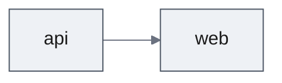

# PRD: [Feature Name]

<!--
Depth: `full` | `lite` — set by scale (documentation-criteria, "PRD depth").
What this document owns, and what belongs to the UXRD or the Design Doc: documentation-criteria, PRD "Includes" and "Excludes".
Reader rules: documentation-criteria, "Writing for the Reader".
-->

| Date | Depth |
|---|---|
| YYYY-MM-DD | full / lite |

## Snapshot

**Overview.** [Three to five plain sentences: the problem the users have today and why it matters, then what they can do once this ships. No IDs.]

- **Not included**: [the one or two things a reader would expect here, from Won't Have]
- **Biggest risk**: [one line]
- **Open questions**: [a link to Undetermined Items — delete the line when there are none]

## Terms

<!-- When applicable. Later documents add only terms that are new to them. -->

- **[Term]**: [what it means here, in a few plain words]

## Background

<!-- What exists today, why now, and the context a reader needs to judge the problem. The Overview already states the problem; do not restate it. Market context, when needed, is a sentence here with its source linked. -->

[What exists today and why this is needed now]

## Users and Use Cases

### Users

- **[User type]** — [who they are, and what matters to them in this feature]

### Use Cases

<!-- Who, what they achieve, the outcome, and why it matters to them — no interface elements (buttons, menus, keys) and no system internals; the UXRD draws the path through the screens and later documents cite these IDs. -->

- **UC-1**: [user] [achieves what] → [outcome], so that [value]
- **UC-2**: [user] [achieves what] → [outcome], so that [value]

## Functional Requirements

<!-- Every requirement carries a MoSCoW priority and an acceptance criterion.
`Won't Have` is recorded, not omitted — an unlisted exclusion is rediscovered during implementation.
IDs: requirements `FR-01`, their criteria `AC-01.1`, `AC-01.2`; later documents cite these. -->

### Must Have (MVP)

- **FR-01. [Short name].** [What the user can do and the need it answers, in one or two sentences]
  - AC-01.1: Given [state], when [action], then [what the user observes — "the open thread is marked as current", not how it is worded, styled, or produced]
- **FR-02. [Short name].** [...]
  - AC-02.1: [...]

### Should Have

<!-- When applicable. -->

- **FR-03. [Short name].** [...]
  - AC-03.1: [...]

### Could Have

<!-- When applicable. -->

- **FR-04. [Short name].** [...]
  - AC-04.1: [...]

### Won't Have

<!-- Everything a reader might expect here that is not delivered: deferred to a later release, or not part of this feature at all. -->

- [What is left out] — [later release / not this feature], [why]

## Non-Functional Requirements

<!-- Only the categories this feature sets a requirement for — performance, reliability, security, scalability, accessibility and responsiveness; delete the rest. When the feature sets none, one line: "none beyond project defaults".
Each requirement has an ID (`NFR-01`) and states a target that can be checked. Accessibility and responsiveness give the target level only ("WCAG 2.1 AA", "usable from 360 px width"). -->

### [Category]

- **NFR-01**: [target]

## Delivery Parts

<!-- Criteria: `documentation-criteria`, "Parts". -->

| Part | Covers | Cut along | Depends on | Rationale |
|------|--------|-----------|------------|-----------|
| `[part-name]` | [FR-01, FR-03] | [backend / frontend / domain / release-unit] | — | [Why this is a separate slice, one sentence] |
| `[part-name]` | [FR-02] | [...] | `[part-name]` | [...] |

- Deferred: [FR-nn assigned to no part] — [why]

### Part Dependency Diagram

<!-- When applicable: three or more parts (with two, the Depends on column already says it). An arrow points from a part to the part whose approved design it consumes. -->

## Success Criteria

<!-- Acceptance criteria prove the feature works; success criteria prove it was worth building. -->

- [what is measured] — [target], read from [where], by [when]

## Constraints and Risks

<!-- Required at full depth; at lite depth, when the feature has any. -->

### Constraints

- [a limit the solution must respect — business, legal, a deadline, or a technical choice the user fixed as a product decision — in a sentence]

### Assumptions and Risks

[What the decision rests on that is unconfirmed, and what could make the feature fail its users — each in a sentence]

## Undetermined Items

<!-- When applicable: a question is open. -->

- [Question] — [the options or what it affects]; blocks [what]; resolved by [who]

## Update History

| Version | Date | Change |
|---------|------|--------|
| 1.0 | YYYY-MM-DD | Initial version |
