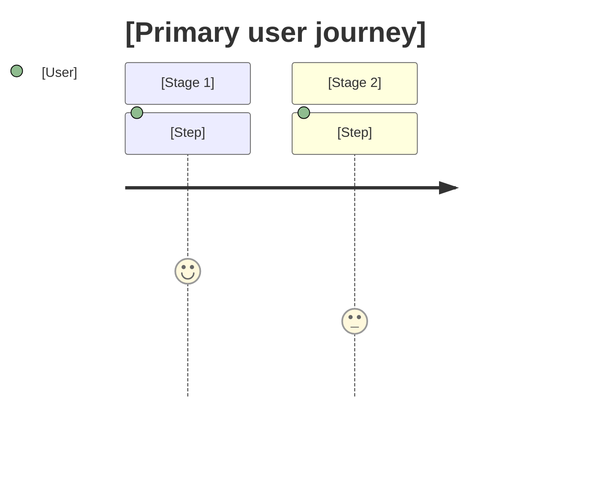
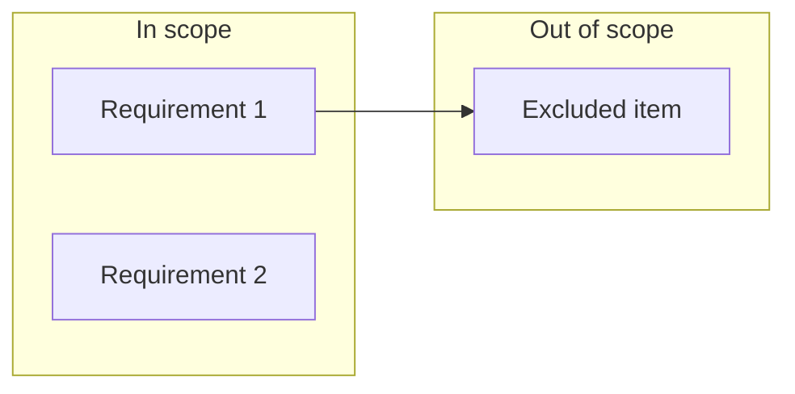
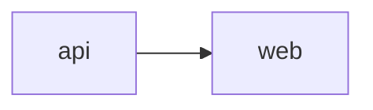

# PRD: [Feature Name]

<!--
Depth: `full` | `lite` — set by scale (documentation-criteria, "PRD depth"). Sections marked (full depth) are omitted in a lite PRD.
The PRD says what the user achieves, not what the screen looks like. Screen states, microcopy, ARIA and focus behaviour, breakpoints,
tokens, and animation belong to the UXRD; technical choices and decisions for the design belong to the Design Doc.
Later documents cite this PRD by ID (UC-2, AC-01.3) instead of restating it.
Reader rules: documentation-criteria, "Writing for the Reader". Guidance in these comments is not copied into the document.
-->

| Status | Date | Depth | UXRD | Designs |
|---|---|---|---|---|
| Draft / Approved | YYYY-MM-DD | full / lite | [uxrd.md](./uxrd.md) or — | [design-[part].md] or — |

## Overview

### Snapshot

<!-- At most ten lines: what the feature gives the user, for whom, the Must Have count, the delivery parts, the biggest risk. -->

- **In one line**: [what the user can do after this ships that they cannot do now]
- **For**: [primary users]
- **Must Have**: [count] requirements · **Parts**: [part names]
- **Biggest risk**: [one line]

### Background

<!-- At most three short paragraphs: the problem and why now. Market context, when needed, goes to Appendix → References. -->

[Why is this feature needed? What problem does it solve?]

## User Stories

### Primary Users
[Define the main target users]

### User Stories
```
As a [user type]
I want to [goal/desire]
So that [expected value/benefit]
```

### Use Cases

<!-- Who, what they achieve, and the outcome — no interface elements (buttons, menus, keys); the UXRD draws the path through the screens and cites these IDs. -->

- **UC-1**: [user] [achieves what] → [outcome]
- **UC-2**: [user] [achieves what] → [outcome]

### User Journey Diagram *(full depth)*



## Functional Requirements

<!-- Every requirement carries a MoSCoW priority and an acceptance criterion. `Won't Have` is recorded, not omitted — an unlisted exclusion is rediscovered during implementation. -->

### Must Have (MVP)
- [ ] Requirement 1: [Detailed description]
  - AC: [Acceptance criteria - Given/When/Then format or measurable standard. An observable outcome for the user ("the open thread is marked as current"), not its markup or styling ("`aria-current` is set", "a skeleton is shown")]
- [ ] Requirement 2: [Detailed description]
  - AC: [Acceptance criteria]
- [ ] Requirement 3: [Detailed description]
  - AC: [Acceptance criteria]

### Should Have
- [ ] Requirement 4: [Detailed description]
  - AC: [Acceptance criteria]

### Could Have
- [ ] Requirement 5: [Detailed description]
  - AC: [Acceptance criteria]

### Won't Have (this release)
- Item 1: [Description and reason]
- Item 2: [Description and reason]

### Out of Scope
- Item 1: [Description and reason — work explicitly not part of this feature]
- Item 2: [Description and reason]

### Scope Boundary Diagram *(full depth)*



## Non-Functional Requirements

[Lite depth: list only the requirements this feature sets; write "none beyond project defaults" when that is the case.]

### Performance
- Response Time: [Target value]
- Throughput: [Target value]
- Concurrency: [Target value]

### Reliability
- Availability: [Target value]
- Error Rate: [Target value]

### Security
- [Security requirements details]

### Scalability
- [Considerations for future scaling]

### Accessibility and Responsiveness *(when the feature has a UI)*
- [Target level only — e.g. "WCAG 2.1 AA", "usable from 360 px width", "light and dark themes". How each target is met is the UXRD's]

## Delivery Parts

<!-- Parts split the feature into independently designable slices. Each part receives its own Design Doc (`design-{part}.md`) and its own work plans, designed and built in the dependency order below. The split is proposed here and confirmed by the user at PRD approval; criteria are in the `documentation-criteria` skill, "Parts". -->

| Part | Covers | Cut along | Depends on | Rationale |
|------|--------|-----------|------------|-----------|
| `[part-name]` | [Requirement 1, Requirement 3] | [backend / frontend / domain / release unit] | — | [Why this is a separate slice, one sentence] |
| `[part-name]` | [Requirement 2] | [...] | `[part-name]` | [...] |

<!-- **Coverage**: every Must Have requirement above appears in exactly one row. Should Have and Could Have requirements appear in a row or are deferred here: -->

- Deferred: [Requirement assigned to no part, with reason]

<!-- **Single part**: when the whole feature is one slice, write one row and say why in its rationale ("one layer, one domain, one design holds it"). One part is the common case. -->

### Part Dependency Diagram

[Required when there is more than one part. An arrow points from a part to the part whose approved design it consumes.]



## Success Criteria

### Quantitative Metrics
1. [Measurable success metric 1 — numeric target, measurement method, timeframe]
2. [Measurable success metric 2]
3. [Measurable success metric 3]

### Qualitative Metrics
1. [User experience metric 1]
2. [User experience metric 2]

## Technical Considerations *(full depth)*

### Dependencies
- [Dependencies on existing systems]
- [Dependencies on external services]

### Constraints
- [Technical constraints]
- [Resource constraints]

### Assumptions
- [Prerequisite requiring validation 1]
- [Prerequisite requiring validation 2]

### Risks and Mitigation
| Risk | Impact | Probability | Mitigation |
|------|--------|-------------|------------|
| [Risk 1] | High/Medium/Low | High/Medium/Low | [Countermeasure] |
| [Risk 2] | High/Medium/Low | High/Medium/Low | [Countermeasure] |

## Undetermined Items

- [ ] [Question 1]: [Description of options or impacts]
- [ ] [Question 2]: [Description of options or impacts]

<!-- *Discuss with user until this section is empty, then delete after confirmation* -->

## Appendix *(full depth)*

### References
- [Related document 1]
- [Related document 2]

### Glossary
- **Term 1**: [Definition — product terms; later documents add only terms that are new to them]

## Update History

<!-- One line per version, newest last, a phrase per change. No reviewer IDs. -->

| Version | Date | Change |
|---------|------|--------|
| 1.0 | YYYY-MM-DD | Initial version |
