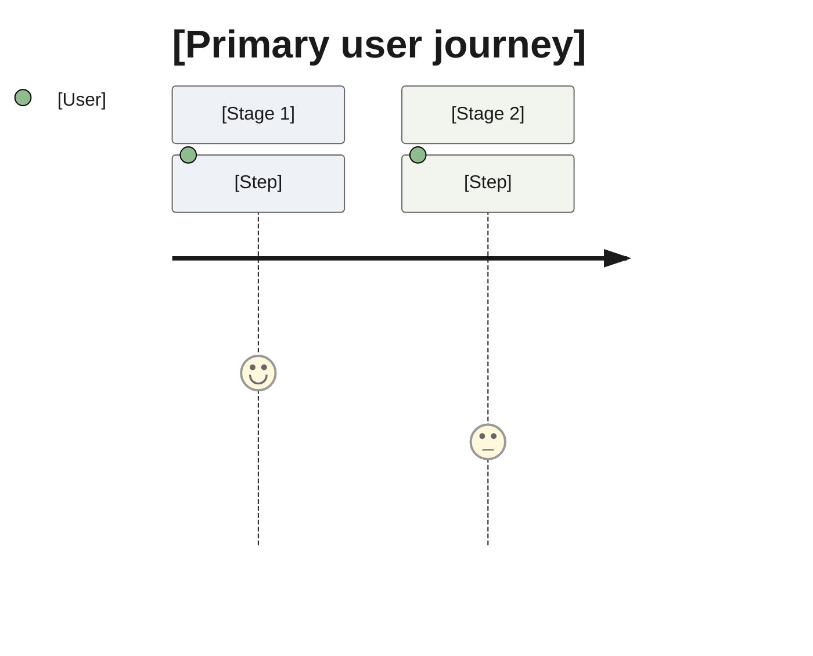
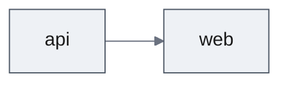

# PRD: [Feature Name]

<!--
Depth: `full` | `lite` — set by scale (documentation-criteria, "PRD depth"). Sections marked (full depth) are omitted in a lite PRD.
The PRD says what the user achieves, not what the screen looks like. Screen states, microcopy, ARIA and focus behaviour, breakpoints,
tokens, and animation belong to the UXRD; technical choices and decisions for the design belong to the Design Doc.
Later documents cite this PRD by ID (UC-2, AC-01.3) instead of restating it.
Reader rules: documentation-criteria, "Writing for the Reader". Guidance in these comments is not copied into the document.
-->

| Status | Date | Depth | UXRD | Designs |
|---|---|---|---|---|
| Draft / Approved | YYYY-MM-DD | full / lite | [uxrd.md](./uxrd.md) or — | [design-[part].md] or — |

## Snapshot

<!-- At most ten lines. The Overview is the story a newcomer needs; the bullets are what they would ask next. -->

**Overview.** [Three to five plain sentences: what problem the users have today, what they can do once this ships, and the core capabilities that make it possible. No IDs.]

- **For**: [primary users]
- **Not included**: [the one or two things a reader would expect here but that are out of scope]
- **Parts**: [part names, in build order]
- **Biggest risk**: [one line]
- **Open questions**: [a link to Undetermined Items, or "none"]

## Terms

<!-- When applicable: the document leans on five or more words a newcomer may not know. One line each. Later documents add only terms that are new to them. -->

- **[Term]**: [what it means here, in a few plain words]

## Background

<!-- At most three short paragraphs: what exists today, why now, and the context a reader needs to judge the problem. The Overview already states the problem; do not restate it. Market context, when needed, goes to Appendix → References. -->

[What exists today and why this is needed now]

## User Stories

### Primary Users

- **[User type]** — [who they are, and what matters to them in this feature]

### User Stories

- As a [user type], I want to [goal], so that [value].

### Use Cases

<!-- Who, what they achieve, and the outcome — no interface elements (buttons, menus, keys); the UXRD draws the path through the screens and cites these IDs. -->

- **UC-1**: [user] [achieves what] → [outcome]
- **UC-2**: [user] [achieves what] → [outcome]

### User Journey Diagram *(full depth)*

## Functional Requirements

<!-- Every requirement carries a MoSCoW priority and an acceptance criterion. `Won't Have` is recorded, not omitted — an unlisted exclusion is rediscovered during implementation.
IDs: requirements `FR-01`, their criteria `AC-01.1`, `AC-01.2`; later documents cite these. -->

### Must Have (MVP)

- **FR-01. [Short name].** [What the user or the system can do, in one or two sentences]
  - AC-01.1: Given [state], when [action], then [observable outcome for the user — "the open thread is marked as current", not its markup or styling ("`aria-current` is set", "a skeleton is shown")]
- **FR-02. [Short name].** [...]
  - AC-02.1: [...]

### Should Have

- **FR-03. [Short name].** [...]
  - AC-03.1: [...]

### Could Have

- **FR-04. [Short name].** [...]
  - AC-04.1: [...]

### Won't Have (this release)

- [What is left out] — [why]

### Out of Scope

- [Work explicitly not part of this feature] — [why]

## Non-Functional Requirements

<!-- Only the categories this feature sets a requirement for — performance, reliability, security, scalability, accessibility and responsiveness; delete the rest. When the feature sets none, one line: "none beyond project defaults".
Each requirement has an ID (`NFR-01`) and states a target and how it is measured. Accessibility and responsiveness give the target level only ("WCAG 2.1 AA", "usable from 360 px width"); how each is met is the UXRD's. -->

### [Category]

- **NFR-01**: [target, and how it is measured]

## Delivery Parts

<!-- Parts split the feature into independently designable slices. Each part receives its own Design Doc (`design-{part}.md`) and its own work plans, designed and built in the dependency order below. The split is proposed here and confirmed by the user at PRD approval; criteria are in the `documentation-criteria` skill, "Parts". -->

| Part | Covers | Cut along | Depends on | Rationale |
|------|--------|-----------|------------|-----------|
| `[part-name]` | [FR-01, FR-03] | [backend / frontend / domain / release-unit] | — | [Why this is a separate slice, one sentence] |
| `[part-name]` | [FR-02] | [...] | `[part-name]` | [...] |

<!-- **Coverage**: every Must Have requirement above appears in exactly one row. Should Have and Could Have requirements appear in a row or are deferred here: -->

- Deferred: [FR-nn assigned to no part] — [why]

<!-- **Single part**: when the whole feature is one slice, write one row and say why in its rationale ("one layer, one domain, one design holds it"). One part is the common case. -->

### Part Dependency Diagram

<!-- Required when there is more than one part. An arrow points from a part to the part whose approved design it consumes. -->

## Success Criteria

### Quantitative Metrics
1. [Measurable success metric 1 — numeric target, measurement method, timeframe]
2. [Measurable success metric 2]
3. [Measurable success metric 3]

### Qualitative Metrics
1. [User experience metric 1]
2. [User experience metric 2]

## Technical Considerations *(full depth)*

### Dependencies
- [Dependencies on existing systems]
- [Dependencies on external services]

### Constraints
- [Technical constraints]
- [Resource constraints]

### Assumptions
- [Prerequisite requiring validation 1]
- [Prerequisite requiring validation 2]

### Risks and Mitigation
| Risk | Impact | Probability | Mitigation |
|------|--------|-------------|------------|
| [Risk 1] | High/Medium/Low | High/Medium/Low | [Countermeasure] |
| [Risk 2] | High/Medium/Low | High/Medium/Low | [Countermeasure] |

## Undetermined Items

- [Question] — [the options or what it affects]; blocks [what]; resolved by [who]

<!-- *Discuss with user until this section is empty, then delete after confirmation* -->

## Appendix *(full depth)*

### References

- [Related document 1]

## Update History

<!-- One line per version, newest last, a phrase per change. No reviewer IDs. -->

| Version | Date | Change |
|---------|------|--------|
| 1.0 | YYYY-MM-DD | Initial version |
