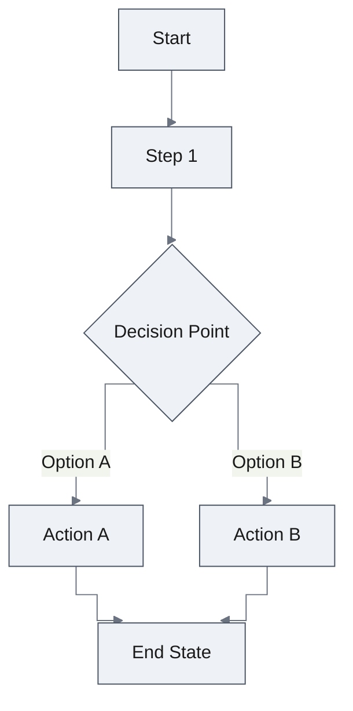

# UXRD: [Feature Name]

<!--
What this document owns, and what belongs to the PRD (gamedev: feature spec) or the design system: documentation-criteria, UXRD "Includes" and "Excludes".
Later documents cite this one by ID: KD-n, MC-n, and any screen element ID the author assigns (TH-10).
Reader rules: documentation-criteria, "Writing for the Reader".
-->

| Date | PRD (gamedev: feature spec) |
|---|---|
| YYYY-MM-DD | [prd.md](./prd.md) |

## Snapshot

**Overview.** [Three to five plain sentences: the user need this interface answers, what the user sees and does, and which screens and surfaces it covers. No IDs.]

- **Does not change**: [the one or two surfaces a reader would otherwise assume change]
- **Biggest UX risk**: [one line]
- **Open questions**: [a link to Undetermined Items — delete the line when there are none]

### Key Decisions

<!-- The UX decisions a reviewer would argue about. Other sections cite KD-n; no paragraph after the table repeats the Why. -->

| ID | Decision | Why |
|---|---|---|
| KD-1 | [what was decided] | [the user need or problem it answers, in words a newcomer follows] |

## Terms

<!-- When applicable: UX words the PRD's Terms do not already explain. -->

- **[Term]**: [what it means here, in a few plain words]

## Design System

<!-- Workflow (create, reuse, extend): `design-system`, "Workflow". The inventory lists only the components this UXRD's own screens use. -->

Follows the [design system](../../design-system/README.md).

### Component Inventory

| Component | Spec | Status | Note |
|---|---|---|---|
| [Button] | [button.md](../../design-system/components/button.md) | reused | — |
| [Thread list] | [thread-list.md](../../design-system/components/thread-list.md) | extended | [what was added — variant, state] |
| [Feature card] | [feature-card.md](../../design-system/components/feature-card.md) | new | [what was searched and why nothing fit] |

## User Flows

### Primary User Flow

**Implements:** [UC and AC ids from the PRD (gamedev: AC ids from the feature spec)]



[Only what the diagram cannot show — delete when there is nothing]

### Alternative Flows

<!-- When applicable: the path branches. -->

[Each branch of the path, naming the UC or AC ids it serves]

### Error Flows

[Each error path, naming the screen state and MC ids that show it]

## Screens

<!-- Each screen is a composition of inventory components. Write what is specific to this screen — placement, behaviour, the screen's own states. -->

### Screen 1: [Screen Name]

```
+------------------------------------------+
|  Header / Navigation                     |
+------------------------------------------+
|                                          |
|  [Main Content Area]                     |
|                                          |
|  +----------------+  +----------------+  |
|  |   Component 1  |  |   Component 2  |  |
|  +----------------+  +----------------+  |
|                                          |
+------------------------------------------+
|  Footer / Actions                        |
+------------------------------------------+
```

**Layout**:

- [Placement and behaviour specific to this screen]

**Screen states**:

<!-- States of the screen as a whole; delete rows that cannot occur. -->

| State | What shows | AC |
|---|---|---|
| Loading | [which components show which state] | [AC ids or —] |
| Empty | [what renders, and the action offered] | [...] |
| Error | [display and recovery] | [...] |

### Screen 2: [Screen Name]

[Add additional screens as needed]

## Accessibility

<!-- Screen-level rules only. Role, accessible name, keyboard, and focus of each component live in its spec. -->

- **Focus order across screens**: [where focus lands on navigation, and any other focus move no component spec decides]
- **Announcements**: [route changes and live updates the screen reader hears]
- **Reduced motion**: [feature-specific behaviour beyond the foundations rule — delete the line when there is none]

## Responsive Behavior

[Per screen, what changes at which width]

## Content and Microcopy

<!-- The one list of strings in this feature — titles, labels, placeholders, validation, error, empty, and loading text. Localization works from this table; no second list. A component's generic copy rules are in its spec. -->

| ID | Where (screen / component / state) | Text |
|---|---|---|
| MC-1 | [Screen — Button, primary] | [Label] |

## Undetermined Items

<!-- When applicable: a UX question is open. A product question goes back to the PRD; a technical one goes to the Design Doc. -->

- [Question] — [the options or what it affects]; blocks [what]; resolved by [who]

## Update History

| Version | Date | Change |
|---------|------|--------|
| 1.0 | YYYY-MM-DD | Initial version |
