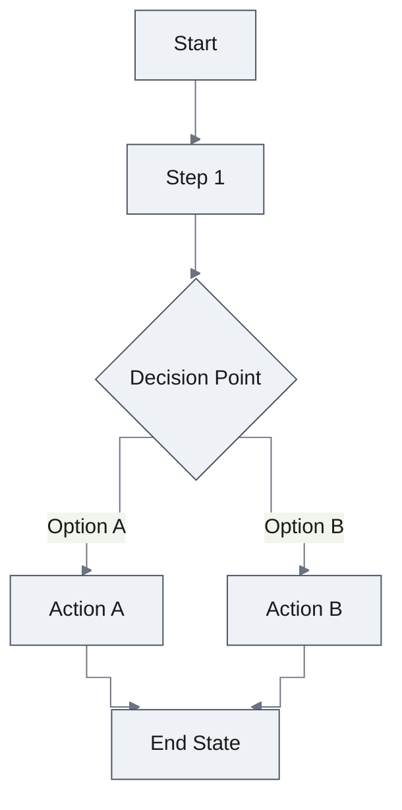

# UXRD: [Feature Name]

<!--
The PRD owns the summary, background, users, use cases, and requirements. This document cites them by ID (UC-2, AC-01.3) and never restates them.
The design system (docs/design-system/) owns foundations and component specs. This document links to them and keeps only feature-level UX: flows, screens, global accessibility, responsive behaviour, and copy.
Reader rules: documentation-criteria, "Writing for the Reader". Guidance in these comments is not copied into the document.
-->

| Status | Date | PRD | Designs |
|---|---|---|---|
| Draft / Approved | YYYY-MM-DD | [prd.md](./prd.md) | [design-[part].md] or — |

## Snapshot

<!-- At most ten lines. -->

- **UX scope**: [which screens and surfaces this document specifies]
- **Screens**: [list]
- **Biggest UX risk**: [one line]

### Key Decisions

<!-- Three to seven rows: the UX decisions a reviewer would argue about. Other sections cite KD-n. The Why column is the rationale; no paragraph after the table repeats it.
A change to an existing design-system foundation or component is a Key Decision here; the design-system file states the result. -->

| ID | Decision | Why | Rejected alternative |
|---|---|---|---|
| KD-1 | [what was decided] | [one phrase] | [the option not taken] |

## AC Traceability

<!-- Maps PRD acceptance criteria to the screens and states that satisfy them. Without this table a UXRD can look complete while leaving an acceptance criterion with no surface that delivers it. -->

| AC ID | Screen / State | Reference (element ID / prototype path) | Adoption Decision |
|-------|----------------|----------------------------------------|-------------------|
| AC-001 | [Screen / state name] | [element or file reference] | Adopted / Not adopted / On hold — [reason when not Adopted] |

<!-- No AC summary column: the AC text lives in the PRD, and the ID is enough to find it. -->

<!-- Every AC in the PRD that has a user-visible surface needs a row. An AC with no row is either out of UX scope — state that explicitly — or an omission. -->

## Design System

<!--
When docs/design-system/ does not exist yet, this pass creates it (README, foundations, and the components below) from design-system-template.md.
Decide reuse before specifying appearance: search the design system and the code before marking a component `new`. Skipping this is how a fourth almost-identical button enters a design system.
`extended` and `new` specs are written into docs/design-system/components/ in the same pass. Their states, variants, and accessibility live there, not here.
-->

Follows the [design system](../../design-system/README.md).

### Component Inventory

| Component | Spec | Status | Note |
|---|---|---|---|
| [Button] | [button.md](../../design-system/components/button.md) | reused | — |
| [Thread list] | [thread-list.md](../../design-system/components/thread-list.md) | extended | [what was added — variant, state] |
| [Feature card] | [feature-card.md](../../design-system/components/feature-card.md) | new | [what was searched and why nothing fit] |

## User Flows

### Primary User Flow

**Implements:** [UC ids from the PRD]

[The path through the screens — what the user sees and does at each step. The use case's goal and outcome are in the PRD and are not repeated here.]



### Alternative Flows

[Edge cases and alternative paths, each naming the UC or AC it serves]

### Error Flows

[Describe how errors are handled in the user flow]

## Screens

<!-- Each screen is a composition of inventory components. Write what is specific to this screen — layout, placement, which variant is used, the screen's own states. A component's states and accessibility are in its spec and are not repeated here. -->

### Screen 1: [Screen Name]

```
+------------------------------------------+
|  Header / Navigation                     |
+------------------------------------------+
|                                          |
|  [Main Content Area]                     |
|                                          |
|  +----------------+  +----------------+  |
|  |   Component 1  |  |   Component 2  |  |
|  +----------------+  +----------------+  |
|                                          |
+------------------------------------------+
|  Footer / Actions                        |
+------------------------------------------+
```

**Layout**:

- [Placement, alignment, and spacing specific to this screen — spacing values cite foundations]

**Screen states**:

<!-- States of the screen as a whole; delete rows that cannot occur. -->

| State | What shows |
|---|---|
| Loading | [which components show which state] |
| Empty | [what renders, and the action offered] |
| Error | [display and recovery] |

### Screen 2: [Screen Name]

[Add additional screens as needed]

## Accessibility

<!-- Global rules only. Role, accessible name, keyboard, and focus of each component live in its spec. -->

- **Target level**: [cite the PRD requirement that sets it, e.g. NFR-03]
- **Focus order across screens**: [where focus lands on navigation, after dialogs close, after an item is removed]
- **Announcements**: [route changes and live updates the screen reader hears]
- **Contrast**: [the target; color roles cite foundations]
- **Reduced motion**: [feature-specific behaviour beyond the foundations rule, or "foundations rule applies"]

## Responsive Behavior

| Breakpoint | Width | Screen | What changes |
|---|---|---|---|
| Mobile | < 640px | [screen] | [one phrase] |
| Tablet | 640px - 1024px | [screen] | [one phrase] |
| Desktop | > 1024px | [screen] | [one phrase] |

## Content and Microcopy

<!-- The one list of strings in this feature — titles, labels, placeholders, validation, error, empty, and loading text. Localization works from this table; no second list. A component's generic copy rules are in its spec. -->

| ID | Where (screen / component / state) | Text | Notes |
|---|---|---|---|
| MC-1 | [Screen — Button, primary] | [Label] | [one phrase] |

## Undetermined Items

<!-- Only UX questions this document must settle. A product question goes back to the PRD; a technical one goes to the Design Doc. -->

- [ ] [Question 1]: [Options or impacts to discuss]
- [ ] [Question 2]: [Options or impacts to discuss]

<!-- _Discuss with stakeholders until this section is empty, then delete after confirmation_ -->

## Appendix

<!-- References and glossary only. A manual acceptance scenario repeats the ACs and flows; it is not written here. -->

### References

- [User research findings, usability test results, design files]

### Glossary

- **Term 1**: [Definition — only UX terms not already in the PRD glossary]

## Update History

<!-- One line per version, newest last, a phrase per change. No reviewer IDs. -->

| Version | Date | Change |
|---------|------|--------|
| 1.0 | YYYY-MM-DD | Initial version |
