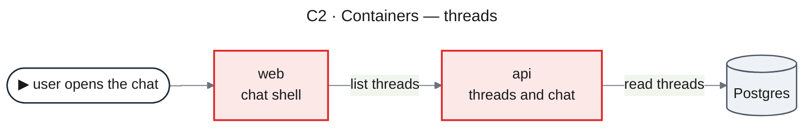
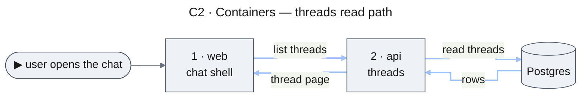

# Mermaid Diagrams

A diagram in a design document is read twice: by a human who must understand the change without reading the prose, and by the next agent, which re-reads the document token by token. Both are served by the same thing — few boxes, short labels, one direction of flow, a colour that means the same in every diagram. A diagram that has to be explained in a paragraph has failed at its one job.

**In scope**: every Mermaid block in a document produced by the overture flow. The C1–C4 levels and runtime flows apply to the Design Doc and are specified in [references/c4-levels.md](references/c4-levels.md).

## 1. Rendering target

- **Mermaid 11.x**, rendered by a browser Markdown viewer with a Mermaid plugin. Do not use Mermaid 12-only syntax.
- The render check pins Mermaid **11.16.1** (section 8). A diagram that fails the check is broken, whatever it looks like elsewhere.
- When unsure whether a feature renders, put it alone in a probe `.md` in the scratchpad, render it with the script, and look at the PNG. Unverified syntax does not go into a document.

## 2. Diagram first

- **Lead with the visual.** A section that describes a structure, a flow, or a state change opens with its diagram; a sentence that only retells the diagram is deleted.
- **Diagrams restate facts already established** — in the code, the PRD, or the document's own tables. Invent no step, edge, or participant; when a flow needs a leg nobody has described, record it as an open question instead of drawing it.
- **Every identifier in a diagram is verified** in code or in the upstream document before it is drawn. A step the code does not support is dropped, not invented.
- **One `> **Why** — …` callout per diagram at most.** No legends that explain colours, shapes, or "lights up in order". A line under a diagram is allowed only when it says something the diagram cannot (a unit, an abbreviation).

## 3. Redraw test

A diagram is good when it can be redrawn from memory at a whiteboard in two minutes and still say the same thing.

- **Node budget.** C1 ≤ 6, C2 ≤ 8, C3 and C4 ≤ 10, any other flowchart ≤ 10 nodes. Over the limit → split into two diagrams (write side / read side), never shrink the font.
- **Label length.** A node is a name plus at most one short role line (`threads<br/>owns the thread list`). Field lists, file paths, method names, and sentences go into tables or prose. Edge labels are 1–4 domain words.
- **No step codes** (`W1`, `R1`, `S3`) anywhere — not on edges, not in prose. When order matters, the step number sits in the node: `1 · ThreadsController`.
- **Single flow direction** per diagram, the main path on a straight line, side effects off to the side, no crossing edges on the main path. If the layout engine crosses them, reorder the nodes in the source (section 7).
- **Sequential calls are a numbered chain**, never a star fanning out of one node — a star reads as parallel branches.
- **Shapes carry meaning only:** box = service or component, cylinder `[( )]` = data store, stadium `([ ])` = external system or person, diamond = decision, stadium with `▶` = entry. No decorative shapes.

## 4. Palette and frontmatter

Four colours, the same meaning on screen and on a whiteboard:

| Colour | Node | Edge | Meaning |
|---|---|---|---|
| black | fill `#eef1f5`, stroke `#4b5563` | `#6b7280` 1.5px | exists, unchanged |
| red | fill `#fde8e8`, stroke `#dc2626` | write path: base `#f4a5a5` 2px, lit `#991b1b` 6px | node changed; edge writes |
| blue | — | read path: base `#9ec1f7` 2px, lit `#1d4ed8` 6px | edge reads |
| green | fill `#e6f4ea`, stroke `#16a34a` | — | node new |

- **Change is shown by node colour only.** No `[NEW]` / `[MODIFY]` / `[READ]` text inside a diagram; tables keep the tags.
- No fifth colour. A risk or decision path is a dashed black edge with a label.
- Every diagram of a document carries the **same frontmatter `config:` block**; a flowchart also sets `curve: step`:



(The example omits path animation for brevity; section 5 adds it.)

## 5. Path animation

**Mandatory** on every flowchart that shows a path (C1–C4, data flows) and on every runtime flow diagram. Skipped only on a diagram with no path — a hierarchy, a state machine, a Gantt chart, a dependency graph. Added in the same pass that draws the diagram, not as later polish.

- **The path is continuous**: request legs and response legs are both drawn (client → api → store → api → client). A read path that jumps from a request to an unrelated response makes the animation jump.
- **Order**: all write steps first, then all read steps. Node step numbers follow the same order.
- **Contrast**: base edges pale and thin, the lit step dark and thick. A width-only change is not visible enough.

### Flowcharts

1. Give every path edge an ID: `web e1@-->|"list threads"| api`.
2. In frontmatter `themeCSS`, define two keyframes **scoped to this diagram** (keyframe names are page-global): `lit_<id>` for write, `litr_<id>` for read.
3. With N path steps, stride 1.2 s, cycle C = N × 1.2 s: lit window `0%..(90/N)%`, off from `(100/N)%`, the off step with **explicit** base values (an empty `50%,100%{}` step is dropped from the SVG and the edge fades instead of switching off).
4. One `classDef` per step: base colour + animation + delay `(k−1) × 1.2s`, applied to the edge ID with `class e1 w1`.
5. Remove `@{ animation: … }` from those edges — the dash animation fights the path animation.



### Sequence diagrams

Every message line in the rendered SVG carries `class="messageLine0|1"` and `data-id="iN"`. Target it from `themeCSS`:

```
.messageLine0[data-id='i3'],.messageLine1[data-id='i3']{animation:lit_s2 7.2s linear 1.2s infinite}
```

**Message IDs come from the rendered SVG** — notes, rects, and activations consume IDs, so they are not 1..n. The check script prints the ID of every message (section 8); write the rules from that list. Off colour for messages: `#37474f` 2px; lit: `#991b1b` for write, `#1d4ed8` for read.

## 6. Runtime flow diagrams

- **The sequence diagram is the flow.** Each runtime flow has a **Starts when** line, its diagram, an **Outcome** line (result and persisted state the picture does not show), and **Failure handling** as a list.
- **One message per step.** Every `alt` / `else` branch ends with its own return; no return follows the `end`.
- **A store never replies.** Row state is a `Note over Writer,Store: …`, not `DB-->>Service`.
- **One journey shape per document.** All runtime flows of one document follow the same journey (client → api → store, note, api → client); a flow whose behaviour never reaches the store (a validation rejection, a cache hit) ends where the behaviour ends rather than drawing an access that does not happen. A reply without a request is a defect.
- **Platform participants in a `box`**; an external system's message goes before a coloured `rect` block, never inside it (the rect stretches out of the box).

## 7. Do not use

| Don't | Why |
|---|---|
| `fontFamily` / `fontSize` in `themeVariables` | custom fonts are not wanted |
| `sequence: mirrorActors: false` | lifelines end in nothing — the bottom looks cut off |
| actor menus `link X: label @ url` | popups do not open in the viewer; on typed participants they crash 11.16.1 |
| links inside diagrams (`click … href`, `<a href>` in labels) | diagrams render in a sandbox; links resolve against it and die. Code locations go into the **Code locations** list under the diagram as relative Markdown links |
| Markdown links `[x](y)` in node labels | rendered as plain text |
| `;` inside sequence messages or notes | ends the statement → parse error |
| `#` inside sequence text | starts a comment |
| tooling as nodes (`pnpm build`, `prisma generate`) | noise; a build step is not runtime |
| delivery as nodes (a migration run, a deploy, a toggle flip, a team) | diagrams draw the running system; delivery belongs in Migration Strategy and the work plan |
| a subgraph with its own `direction` that outside arrows target | every outside arrow lands on the frame edge, not on the node inside |
| `A --> subgraphId` | routes to the border and crosses; attach to a node inside |
| UML `classDiagram` for C4; ASCII box art for a flow or structure | fails the redraw test / not rendered. A UXRD wireframe sketch in a plain text block is the one place ASCII layout is allowed |
| C4 element-type tags in labels (`[Container]`, `[Component]`, `[Person]`) | noise; the level is in the title |

**Layout workarounds (11.16.1)**: dagre pushes a node with several incoming edges to the far end — pin the layout with invisible links (`a ~~~ b`) and declaration order. `flowchart RL` mirrors a data-flow diagram so a system keeps its side across levels.

## 8. Render check

`scripts/check-mermaid.mjs` (in this skill's directory, `${CLAUDE_PLUGIN_ROOT}/skills/mermaid-diagrams/scripts/check-mermaid.mjs`):

```
node check-mermaid.mjs <doc.md> <outdir>
```

- `<outdir>` is in the session scratchpad, never in the repository.
- On first use it installs `@mermaid-js/mermaid-cli` pinned to Mermaid 11.16.1 into `<outdir>/../mmdc` (needs `npm` and network once).
- It extracts every Mermaid block (including indented ones), renders SVG and PNG, and fails on a syntax error.
- It lints the source against section 7 and checks that every path flowchart has scoped keyframes and an animated class on its path edges.
- For every sequence diagram it prints `order · data-id · from→to · delay · keyframe · text` and fails on a message without an animation rule, a rule hitting no message, delays not strictly increasing, or a reply with no earlier request. It warns when runtime flows differ in journey shape.

**Run it before declaring a document done**, and look at the PNG of at least one C-level diagram and one runtime flow. When it cannot run (no `node`/`npm`, no network for the first install), say so in the response summary — never report diagrams as checked when they were not.

## 9. Revisions

A revision — after review or a user change — re-runs the render check on the whole document, not only on the diagrams that were touched: a renamed component changes C2, C3, C4, and every runtime flow it appears in. The same system keeps its place across C1, C2, and C3 after the edit.
