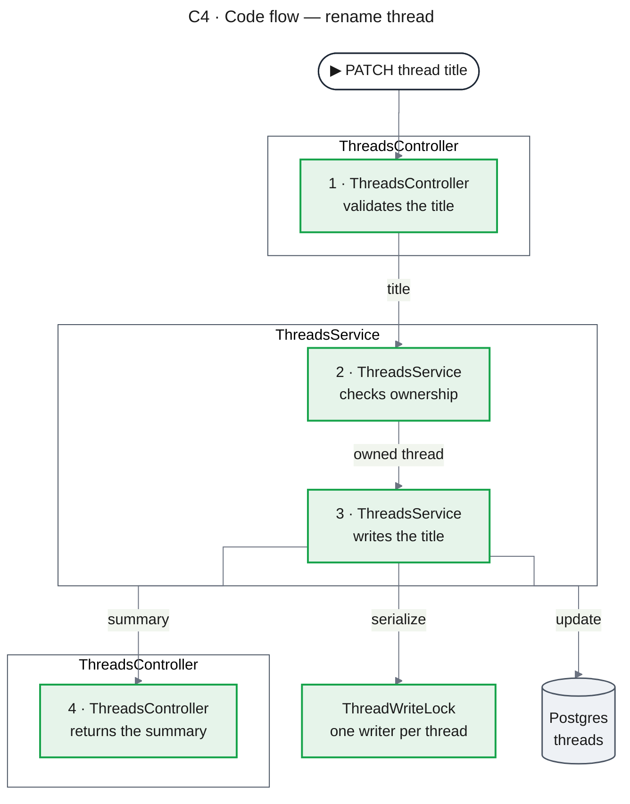

# C1–C4 Levels in the Design Doc

The Design Doc zooms in four steps, after the C4 model (Simon Brown, c4model.com). Each level answers one question and draws only what that question needs; the same system stays in the same place from level to level, so the reader — and a hand-drawn copy — zooms in instead of starting over.

| Level | Question | Draws | Direction | Max nodes | When |
|---|---|---|---|---|---|
| C1 · Context | Who uses the change, and what outside systems does it touch? | the product as **one box**, people and external systems | `flowchart LR` | 6 | omit when the part has no external actor or system that changes behaviour |
| C2 · Containers | Which deployable units and stores take part? | apps, services, workers, databases, queues, browser storage; calls between them | `flowchart LR` | 8 | always |
| C3 · Components | What inside one container does the work? | components of **one** container in call order | `flowchart TB` | 10 | one diagram per container the part changes, per flow it touches |
| C4 · Code flow | Which modules change, and how does data pass through them? | changed classes / functions / components as a vertical step chain | `flowchart TB` | 10 (one long chain may exceed it if it stays readable) | omit when no module-level change |

Every level carries a frontmatter `title:` of the form `"C2 · Containers — <scope>"`, the shared `config:` block, and path animation (SKILL.md sections 4–5).

## Reading the levels for backend and frontend

| Level | Backend part | Frontend part |
|---|---|---|
| C1 | product, users, external APIs (LLM provider, payment provider, IdP) | same — the frontend part draws the same C1 as the backend part, its own box red or green |
| C2 | api, workers, databases, queues, caches | web app, api it calls, browser storage, CDN — the backend appears as one node |
| C3 | inside one service: controller, service, repository, guard, adapter | inside the web app: route / page, feature components, hooks, store, api client |
| C4 | classes and functions in data-flow order | component → hook → store → api client in data-flow order |

## C1 · Context

- The product is one box. Inside nothing is drawn.
- Actors are people or systems that **use the running change**. A team that builds or deploys it is not an actor.
- An entry node `▶ <what the user does>` with an arrow into the first step.

## C2 · Containers

- A dashed boundary subgraph named after the product holds the containers and stores the change touches; actors and external systems sit outside it. The subgraph has no inner `direction`.
- Under the diagram, a table:

| Container | Role | Change |
|---|---|---|
| `api` | threads and chat endpoints | `[MODIFY]` |

## C3 · Components

- One `###` subsection per C2 container marked `[NEW]` or `[MODIFY]`; inside it one diagram per flow, titled `**<container> — <flow>**`.
- Top to bottom: caller and entry node on top, the container's components inside a boundary subgraph named after the container in call order, stores and external systems in the bottom row with nothing below them.
- Another container is one black node; its inside is drawn in its own subsection.
- A component the flow does not touch is not drawn.
- Under the diagram, a table — this replaces a prose component list:

| Component | Responsibility in this flow | Change |
|---|---|---|
| `ThreadsService` | ownership check, list, rename, delete | `[NEW]` |

## C4 · Code flow

- **One vertical chain** (`flowchart TB`). Each changed class or module is a frame (a subgraph **without** `direction`) holding its step nodes; frames stack in data-flow order.
- A step node: `"1 · ClassName what it does"` — class on the first line with the step number, the action on the second.
- Every arrow goes **from a step to a step**, also across frames — never to a frame edge, never a frame-to-frame band.
- The return leg (result, error, response) is its own steps further down the column. Branches split off to the side.
- Collaborators and stores sit beside the column with an arrow from the exact step that uses them; an unchanged collaborator stays black even when the step that calls it changed.
- Two independent entry points (an event that writes, a request that reads) → two diagrams, `C4 · Code flow — write path` and `C4 · Code flow — read path`, with the shared store in both.
- Method names, decorators, and wiring details go in the module table's Notes column, never in the picture.
- A decision rule that needs its own flowchart goes in a `#### How <rule> works` subsection after the chain; it is not a C-level diagram.

(Path animation omitted for brevity; a real C4 diagram carries it.)

Under the chain, two things and nothing else:

**Code locations** — one relative Markdown link per file, with at most a few general words or none. No method or field names. Paths already cited in Code Inspection Evidence are not repeated.

**Module table**:

| Type | Name | Change | Notes |
|---|---|---|---|
| Controller | `ThreadsController` | `[NEW]` | `PATCH /api/threads/:threadId` |
| Service | `ThreadsService` | `[NEW]` | `rename` runs under `ThreadWriteLock` |

## Consistency across levels

- A system on the left in C1 is on the left in C2; in C3 the same systems keep their relative order top to bottom (caller above, stores and externals below).
- A name is spelled the same at every level and in every table.
- A node's colour at one level matches its tag in that level's table, and a container red in C2 has at least one red or green component in its C3.
