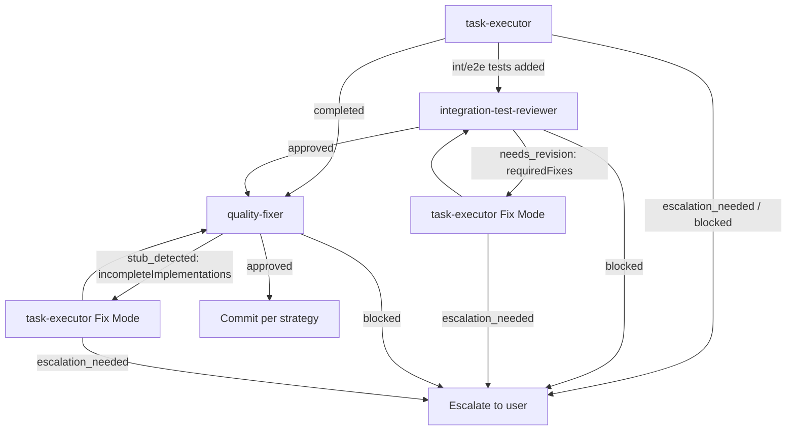
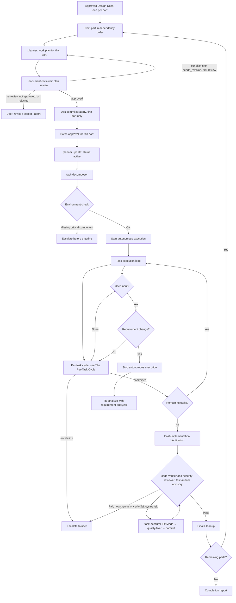

# Autonomous Execution Workflows

Coordination mechanics belong to `workflow-orchestration`; the approved design arrives from `workflow-technical`. This skill covers everything from "we know what to build" to "it is built": planning the work, decomposing it, obtaining batch approval, and then running the loop that proceeds without asking permission.

Planning lives here rather than with design because a plan is a schedule for doing the work, not a statement of what the work is. It also carries the only domain difference in this half of the workflow — the planner agent.

Autonomy is delegated authority, not absence of limits. Every rule below exists because unbounded execution fails in a specific, observed way: it edits far more than intended, retries a broken approach indefinitely, or reports success on work it never verified.

## Entry Gate [BLOCKING]

Run before planning begins.

☐ Parts list received, with an approved Design Doc path for every part (`workflow-technical` exit gate passed) — or, at small scale, the approved lite PRD (the lite feature spec on the gamedev path) and a single part with no design
☐ ADR paths received per part, or an explicit "none passed the test"
☐ Test skeleton paths received per part
☐ PRD and UXRD paths carried through, for plan traceability (feature spec, GDD, and `ui-ux-agent` output on the gamedev path); a small-scale plan's traceability table maps to the PRD's or feature spec's acceptance criteria
☐ The plan state of every part is unambiguous: at most one plan is `status: active`, the plan file count matches `M` in `plan: N of M`, and every `depends-on` resolves

**ENFORCEMENT**: when an item is unchecked, stop and name the missing input and the phase that produces it. An ambiguous plan state in particular must never be resolved by picking one — see "Planning" below.

## Planning

Planning turns an approved design into a schedule the executor can follow, and ends at the authority boundary.

### Planner agent

| Domain | Planner |
|--------|---------|
| Default (backend, frontend, fullstack) | `work-planner` |
| Game development | `gamedev-work-planner` |

Substitute the domain's agent wherever this skill says **`{planner}`**. Nothing else varies by domain.

### One part at a time

Planning and execution run **per part**, in the dependency order of the parts list: plan the first part, take its batch approval, build it through its completion report, then plan the next. The whole feature was designed before this phase began, so every contract a part consumes is settled; building in order adds that the upstream part's *code* exists too, and the downstream plan can name real files where the upstream plan could only name designed ones.

Commit strategy is asked once, before the first part's batch approval, and holds for the feature. Batch approval is taken per part: it approves one plan, and one plan covers one part.

### Flow

Run for the current part, then repeat for the next part in the list:

1. **`{planner}`** → work plan at `docs/features/{feature}/{part}/{plan-name}.md`, carrying the frontmatter that positions it within its part (`plan: N of M`, `status`, `depends-on`) and incorporating the part's test skeleton paths
2. **document-reviewer** → work plan review, checking:
   - **Design-to-Plan Traceability** — every Design Doc item has a covering task or a justified gap
   - **Failure Mode Checklist** — all nine categories marked, applicable ones assigned a covering task
   - **Verification Strategy** carried across from the Design Doc, with an early verification point
   - **Reference Contract Values** recorded verbatim where the design specifies a binding observable value
   - **ADR Bindings** present for every ADR the design treats as prerequisite or produced
   `approved_with_conditions` or `needs_revision` → `{planner}` addresses the `critical` and `important` issues, then one re-review with `review_scope: changes`; a re-review that is not `approved`, or `rejected`, goes to the user — see `workflow-orchestration`, "Revision Loop"
3. **Commit strategy selection** — ask the user, first part only (see below)

   **[Stop: batch approval — part `{part}`]**

4. **`{planner}`** (`update` mode) → set the approved plan's frontmatter `status: active`. The orchestrator never edits the file itself; the planner owns it and checks no sibling is already active
5. **task-decomposer** → task files in `docs/features/{feature}/{part}/{plan-name}/`, one per single-commit unit, plus `_overview.md`
6. The per-task cycle, post-implementation verification, and Final Cleanup below, for this part. Its completion report names the next part in the list, or closes the feature when it was the last

Decomposition runs **after** batch approval: it produces working state, not a document under review, and re-decomposing is cheap while re-approving is not.

### Batch approval is the authority boundary

Everything before it is reviewed by a human; everything after runs autonomously until completion or escalation. Do not reach it with an unresolved question — after it, no one is asked again.

Small scale skips the plan review: `{planner}` writes a simplified plan with `design: none` whose traceability table maps to the lite PRD's requirements (the lite feature spec on the gamedev path), batch approval is taken, and the loop runs. The parts list has one entry.

## Entry Conditions

Autonomous mode starts after batch approval and decomposition. Before entering the loop, verify the environment supports what it assumes.

### Pre-Execution Environment Check

**Principle**: verify subagents can complete their responsibilities.

**Required environments**:
- Commit capability (for the per-task commit cycle)
- Quality check tools (quality-fixer detects and escalates if missing)
- Test runner (task-executor detects and escalates if missing)

**If a critical environment is unavailable**: escalate with the specific missing component *before* entering autonomous mode — discovering it mid-loop wastes the approval and leaves partial work.
**If the gap is detectable by a subagent**: proceed; the subagent escalates with fuller context than a pre-check can produce.

### Authority Delegation

Once the environment check passes, batch approval delegates authority to the subagents:

| Agent | Delegated authority |
|-------|---------------------|
| task-executor(-frontend) | Implementation — may use Edit/Write within its File Scope Constraint |
| quality-fixer(-frontend) | Fix authority — automatic quality error fixes |

The orchestrator itself gains no write authority: it still coordinates only.

## Commit Strategy Selection

**Ask before batch approval**, so the user approves the plan and its commit granularity together.

| Strategy | When to Commit | Best For |
|----------|----------------|----------|
| **per-task** | After each task completes | Atomic commits, easy rollback, CI-friendly |
| **per-phase** | After each phase completes | Balanced granularity |
| **per-feature** | Single commit at feature completion | Clean history, squash-like |
| **manual** | User explicitly requests | Full control, interactive workflow |

**Default**: `per-task`.

The strategy affects when `git commit` runs, how quality-fixer cycles are grouped, and commit message granularity. It never affects **whether** quality-fixer runs.

## The Per-Task Cycle



Never commit on `stub_detected`: a stub can pass every other check while implementing nothing.

### Commit execution by strategy

| Strategy | Commit Trigger |
|----------|----------------|
| **per-task** | quality-fixer returns `approved: true` → commit immediately |
| **per-phase** | All tasks in the phase complete + `approved: true` → commit |
| **per-feature** | All phases complete + final `approved: true` → single commit |
| **manual** | User says "commit" or "save progress" → commit staged changes |

**quality-fixer runs after every task regardless of strategy.** Batching commits does not batch quality gates.

## Post-Implementation Verification

The per-task cycle checks each task in isolation. It cannot detect drift between the finished implementation and the Design Doc, nor assess the security posture of the change set as a whole. After **all** task cycles finish — before the completion report — run a whole-implementation pass.

**Invoke the verifiers in parallel** (single message, three Agent calls):

| Verifier | Inputs |
|----------|--------|
| `code-verifier` | `doc_type: design-doc`, Design Doc path, `code_paths` from `git diff --name-only main...HEAD` |
| `security-reviewer` | Design Doc path, same implementation file list |
| `test-auditor` | `testPaths`: the test files in the same diff; Design Doc path |

**`test-auditor` is advisory, never a gate.** Its findings are not converted into `requiredFixes[]` and never dispatched to `task-executor`: deleting or merging an existing test is the user's decision. A `bloated` verdict goes into the completion report as a table of `merge` / `drop` / `move` rows with their reasons, plus the `gaps` list, and the user decides which to apply.

**Pass/fail criteria**:

| Verifier | Pass | Fail | Blocked |
|----------|------|------|---------|
| `code-verifier` | `consistent` or `mostly_consistent` | `needs_review` or `inconsistent` | — |
| `security-reviewer` | `approved` or `approved_with_notes` | `needs_revision` | `blocked` → escalate to user |

**Normalizing output into one `requiredFixes[]`** — the verifiers emit different shapes and must be reconciled before invoking task-executor:

- `security-reviewer.findings[]` → each `confirmed_risk` or `defense_gap` becomes `{location, issue: description, fix: remediation}`
- `code-verifier.discrepancies[]` → each `gap` or `conflict` becomes `{location: discrepancy.codeLocation, issue: discrepancy.claim, fix: "<correction restoring Design Doc consistency, derived from classification and evidence>"}`
- When `discrepancy.codeLocation` is `null` (the claim is unimplemented), set `location` to the planned target file. If no target file can be determined, escalate rather than dispatching Fix Mode with an unresolvable location.
- `drift` means the code moved past the document (code-verifier: "document update needed") — it goes to the completion report, not to the executor.

**Fix cycle** (any verifier failed — maximum 2 cycles; when normalization yields no items, e.g. only `drift`, skip it and report the verdict and drift in the completion report):

1. `task-executor` in **Fix Mode** with the normalized array and `Design Doc: [path]` — no task file; Fix Mode takes its file scope from the fix locations
2. `quality-fixer` → commit per strategy → re-run **only the failed verifiers**, retaining recorded evidence from those that passed

**Re-run rule**: a cycle makes progress only when a previously failing verifier reaches a pass status, or its count of named remaining findings decreases. Escalate immediately when a cycle makes no progress or needs external input. After cycle 2, escalate every remaining failure with its findings.

## Final Cleanup

Before the completion report, delete the task directory this run consumed. Its work is committed; the directory is working state, not a durable artifact.

- Delete `docs/features/{feature}/{part}/{plan-name}/` — `task-*.md`, `_overview.md`, `analysis/` (a Bash `rm` of working state, not a document edit)
- Invoke `{planner}` in `update` mode to set the plan's frontmatter `status` to `completed`, so the next run resolves the following plan in the chain
- **Preserve** sibling plans and their directories — a part may hold several, and only the executed one is finished
- **Preserve** `prd.md`, `uxrd.md`, `design-{part}.md`, and everything under `docs/adr/`

If deletion fails, report the failure but do not block the completion report.

## Stopping Autonomous Execution

### Conditions that force a stop

1. **Escalation from a subagent** — `status: "escalation_needed"` or `status: "blocked"`
2. **Requirement change detected** — any match in the requirement-change checklist; stop and re-analyze with integrated requirements via requirement-analyzer
3. **Work-planner update restriction violated** — requirement changes after task-decomposer has started require overall redesign; restart the flow from requirement-analyzer
4. **User explicitly stops** — direct instruction or interruption

**Resuming after a stop that changes documents.** When the user's answer to an escalation changes the PRD, UXRD, a Design Doc, the plan, or task files, apply it with `workflow-orchestration`, "Revision Loop" → "One change, one round across documents": every owner updates first, one review round over the changed set, one approval. Then the per-task cycle resumes at the task that escalated.

### Quantitative Auto-Stop Triggers

These numeric thresholds MUST trigger immediate orchestrator action. They are non-negotiable safety boundaries, and they take priority over autonomous mode.

| Trigger Condition | Required Action |
|---|---|
| **6+ files changed** in a single task (task-decomposer allows up to 5) | STOP. Create an impact report listing all changed files and affected modules. Present to the user before continuing. |
| **Same error occurs 3 times** | STOP. Mandatory root cause analysis via 5 Whys. Do NOT attempt another fix without completing it. |
| **2nd consecutive error fix attempt** | Re-execute rule-advisor. The previous approach has failed — reassess task essence and strategy. |

**Enforcement rules**:

1. Counters reset at the start of each new task
2. The orchestrator counts from the subagents' returned JSON (`filesModified`, statuses) — it does not see their individual edits
3. Auto-stop triggers take priority over autonomous execution
4. After any auto-stop, present a status report before resuming
5. A user may override with "continue" — but the stop MUST occur first

## Error-Fixing Impulse Control Protocol

When an error appears during implementation, follow this protocol **instead of** immediately attempting a fix. The reflex to patch is what turns one defect into a sequence of increasingly speculative edits.

1. **PAUSE** — do not attempt a fix yet
2. **Re-execute rule-advisor** with the error context:
   ```yaml
   subagent_type: rule-advisor
   prompt: "Re-analyze task considering this error: [error details]. Determine whether the original approach is still valid or a different strategy is needed."
   ```
3. **Root cause analysis** — apply 5 Whys:
   ```
   Error:  [observed error]
   Why 1:  [immediate cause]
   Why 2:  [cause of Why 1]
   Why 3:  [cause of Why 2]
   Why 4:  [cause of Why 3]
   Why 5:  [root cause]
   ```
4. **Present an action plan** — root cause, proposed approach, estimated impact (files to change), risk assessment
5. **Fix only after user approval**

### Applies to

- An error that reaches the orchestrator as a subagent's `escalation_needed` or `blocked`
- The "Same error occurs 3 times" trigger above

### Does NOT apply to

- Expected test failures during Red-Green-Refactor (the TDD red phase)
- Errors quality-fixer fixes inside its own loop — that is its delegated authority
- Known, documented environment issues

## Exit Gate [BLOCKING]

Run before the completion report.

☐ Every task in the Consumed Task Set is committed, or explicitly escalated and reported
☐ Post-implementation verification passed, or its remaining findings were escalated after cycle 2
☐ No `quality-fixer` result was accepted on `non_substantive` test evidence
☐ Final Cleanup ran: the task directory is deleted and the plan's `status` is `completed`
☐ When the part has a further plan in the chain, its `depends-on` is now satisfied and it is reported as the next step
☐ When the parts list has a further part, it is reported as the next part to plan — its `dependsOn` parts are now built, not only designed
☐ The completion report states what was built, what was verified, and anything left escalated

**ENFORCEMENT**: an unchecked item means the run is not finished. Reporting completion with an unverified item is worse than reporting the gap, because it removes the reader's reason to look.

## Execution Flow


