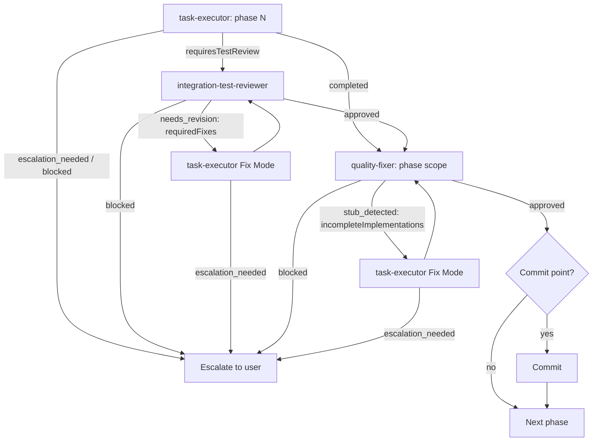

# Autonomous Execution Workflows

Coordination mechanics belong to `workflow-orchestration`; the approved design arrives from `workflow-technical`. This skill covers everything from "we know what to build" to "it is built": planning the work, obtaining batch approval, and then running the loop that proceeds without asking permission.

Planning lives here rather than with design because a plan is a schedule for doing the work, not a statement of what the work is. It also carries the only domain difference in this half of the workflow — the planner agent.

Autonomy is delegated authority, not absence of limits. Every rule below exists because unbounded execution fails in a specific, observed way: it edits far more than intended, retries a broken approach indefinitely, or reports success on work it never verified.

## Planning

Planning turns an approved design into a schedule the executor can follow, and ends at the authority boundary.

### Planner agent

| Domain | Planner |
|--------|---------|
| Default (backend, frontend, fullstack) | `work-planner` |
| Game development | `gamedev-work-planner` |

Substitute the domain's agent wherever this skill says **`{planner}`**. Nothing else varies by domain.

### One part at a time

Planning and execution run **per part**, in the dependency order of the parts list: plan the first part, take its batch approval, build it through its completion report, then plan the next. The whole feature was designed before this phase began, so every contract a part consumes is settled; building in order adds that the upstream part's *code* exists too, and the downstream plan can name real files where the upstream plan could only name designed ones.

Commit strategy is asked once, in the first part's batch approval, and holds for the feature. Batch approval is taken per part: it approves one plan, and one plan covers one part.

### Flow

Run for the current part, then repeat for the next part in the list:

1. **`{planner}`** → work plan at `docs/features/{feature}/{part}/{plan-name}.md`, carrying, when the part has more than one plan, the frontmatter that positions it within its part (`plan: N of M`, `depends-on`), and incorporating the part's test skeleton paths
2. **`{planner}`'s draft check** — `document-reviewer`, run by the planner on the plan it wrote (`documentation-criteria`, "Draft Check"); the orchestrator runs no plan review of its own

   **[Stop: batch approval — part `{part}`]** — shows the plan path and the planner's `draftCheck.open` items, and offers independent review as an option; when the user picks it, `workflow-orchestration`, "Revision Loop" applies before approval. At the first part the same question asks the commit strategy ("Commit Strategy Selection")

3. The phase cycle, post-implementation verification, and Final Cleanup below, for this part. Its completion report names the next part in the list; the last part runs the feature run before its cleanup, and its report closes the feature

### Batch approval is the authority boundary

Everything before it is reviewed by a human; everything after runs autonomously until completion or escalation. Do not reach it with an unresolved question — after it, no one is asked again.

Small scale, and gamedev Prototype mode at any scale, skips step 2: `{planner}` writes a simplified plan with `design: none` whose work items cite the lite PRD's requirements (the lite feature spec on the gamedev path), batch approval is taken, and the loop runs. The parts list has one entry.

## Resolving the Plan to Execute

A command that resumes execution (`/build`, `/front-build`) finds its plan this way:

- **A plan path was given**: use it
- **No path**: read the plans at `docs/features/*/*/*.md` and take the one that holds an unticked or `[🔄]` work item and whose `depends-on` plans are fully ticked. A plan with every work item ticked is finished
- **Several plans qualify**: take the most recently modified plan file — the executor ticks work items in it — and report the choice and the alternatives
- **No plan under `docs/features/*/*/`**: stop — "No work plan found. Pass a work plan path, or complete the planning phase first."

**Which agents run it.** Look up the plan's `part` (frontmatter) in the PRD's Delivery Parts: a part whose "Cut along" is `frontend` runs with `task-executor-frontend` and `quality-fixer-frontend` (`/front-build`), every other part with `task-executor` and `quality-fixer` (`/build`). Each of the two commands stops when the resolved plan belongs to the other and names the command to run instead. gamedev-overture has one pair and skips this check.

Execution resumes at the plan's first `### Phase N` that holds an unticked or `[🔄]` work item; the executor continues from the unticked items. A phase whose items are all `[x]` while its files are still uncommitted under `per-phase` gets its gate (`scope: phase`) and its commit first.

## Entry Conditions

Autonomous mode starts after batch approval. Before entering the loop, verify the environment supports what it assumes.

### Pre-Execution Environment Check

**Principle**: verify subagents can complete their responsibilities.

**Required environments**:
- Commit capability (for the commit cycle)
- Quality check tools and test runner (quality-fixer detects and escalates if missing)

**If a critical environment is unavailable**: escalate with the specific missing component *before* entering autonomous mode — discovering it mid-loop wastes the approval and leaves partial work.
**If the gap is detectable by a subagent**: proceed; the subagent escalates with fuller context than a pre-check can produce.

### Authority Delegation

Once the environment check passes, batch approval delegates authority to the subagents:

| Agent | Delegated authority |
|-------|---------------------|
| task-executor(-frontend) | Implementation — may use Edit/Write within the phase's file scope (its Target Files, and an edit that passes the executor's File Scope test) |
| quality-fixer(-frontend) | Fix authority — automatic quality error fixes |

The orchestrator itself gains no write authority: it still coordinates only.

## Commit Strategy Selection

**Ask in the batch-approval question**, so the user approves the plan and its commit granularity together; `/build` and `/front-build` started on their own do the same.

| Strategy | When to Commit | Best For |
|----------|----------------|----------|
| **per-phase** | After each phase completes | One commit per verified unit of work, easy rollback |
| **per-feature** | Single commit after the feature run | Clean history, squash-like |
| **manual** | User explicitly requests, between phases | Full control, interactive workflow |

**Default**: `per-phase`.

The strategy sets when `git commit` runs and commit message granularity.

## The Phase Cycle

A plan phase is the unit of execution: one executor run implements it, one gate checks it, one commit holds it. The orchestrator runs the plan's phases in order, each through this cycle.

The executor takes `"Work plan: <path>. Phase: N."`, works the phase's items test-first and ticks them in the plan. It runs only the unit tests it writes and the unit test files of the modules it touches, plus one typecheck of the touched package; the integration and e2e files the phase calls for are written and left for the feature run. Never commit on `stub_detected`: a stub can pass every other check while implementing nothing.

### Commit execution by strategy

`quality-fixer` runs at the `scope` the orchestrator passes:

| Scope | When | What runs |
|-------|------|-----------|
| `phase` | After every plan phase, and after a verification fix | Static checks plus the unit test files of what changed. The orchestrator passes `changedFiles`: the union of `filesModified` and `testsAdded` from the executor run being gated |
| `feature` | Once, at the end of the feature — "The Feature Run" | The whole unit suite, integration, e2e, coverage |

| Strategy | quality-fixer | Commit |
|----------|---------------|--------|
| **per-phase** | `phase` scope at phase end | After `approved: true` |
| **per-feature** | `phase` scope at each phase end | One commit after the feature run |
| **manual** | `phase` scope at each phase end | On request between phases, staged changes |

A full suite at every phase end would run the same tests many times over one feature. The unit tests of the changed files catch what the phase broke; the single feature run covers cross-module and end-to-end behaviour.

## Post-Implementation Verification

The phase cycle checks each phase in isolation. It cannot detect drift between the finished implementation and the Design Doc, nor assess the security posture of the change set as a whole. After **all** phase cycles finish — before the completion report — run a whole-implementation pass.

**Invoke the verifiers in parallel** (single message, four Agent calls):

| Verifier | Inputs |
|----------|--------|
| `code-verifier` | `doc_type: design-doc`, Design Doc path, `code_paths`: the part's file list; it reads `docs/code-system/` itself when the project has one |
| `code-reviewer` | `Design Doc Path`, `Implementation Files`: the part's file list, `Code System Path: docs/code-system/` when it exists, `Review Mode: architecture` — conformance of the code to the cited patterns and the codebase |
| `security-reviewer` | Design Doc path, the part's file list |
| `test-auditor` | `testPaths`: the test files in the part's file list; Design Doc path |

**The part's file list** is the union of `filesModified` and `testsAdded` from this run's phase results, committed or not, plus, for this part's phases completed before this run, their Target Files and the files their Investigation Notes record as edited outside them (a resumed `/build` has no earlier results in context). A `git diff` against `main` misses uncommitted work under `per-feature` and `manual`, is empty on `main` itself, and from the second part on carries the first part's code into a check against the wrong Design Doc.

**Small scale** (and gamedev Prototype mode) has no Design Doc: `code-verifier` runs with `doc_type: prd` against the lite PRD (skipped on the gamedev path — the lite feature spec is not a `code-verifier` document type), `code-reviewer`, `security-reviewer` and `test-auditor` take the lite PRD or feature spec in place of the Design Doc, and Fix Mode below receives the same path.

**`test-auditor` is advisory, never a gate.** Its findings are never dispatched to `task-executor`: deleting or merging an existing test is the user's decision. A `bloated` verdict goes into the completion report as a table of `merge` / `drop` / `move` rows with their reasons, plus the `gaps` list, and the user decides which to apply.

`drift` means the code moved past the document (code-verifier: "document update needed") — it goes to the completion report, not to the executor.

**Candidate patterns.** The completion report lists, under one heading, code-verifier's `drift` whose `classification` begins `architectural:` and code-reviewer's `candidatePatterns`. The user confirms which become catalogue entries; each confirmed one goes to the technical designer through `/update-doc` (code system) after the completion report, outside the autonomous run. A candidate is not a defect: it is never dispatched to Fix Mode, and nothing in the run writes to `docs/code-system/`.

**Fix cycle** (a verifier returned a finding of the types in step 1 — maximum 2 cycles; a `security-reviewer` `blocked` goes to the user; when the failures hold nothing to fix, e.g. only `drift`, skip it and report the verdict and drift in the completion report):

1. `task-executor` in **Fix Mode** with `requiredFixes`: from the verifiers, as returned, only code-verifier's `gap` and `conflict` discrepancies, security-reviewer's `confirmed_risk` and `defense_gap` findings, and code-reviewer's `duplicate-block`, `boundary-violation` and `pattern-mismatch` issues — every other finding goes to the completion report, and a finding with no code location (code-verifier's `codeLocation: null`) goes to the user, not to the executor. With them, `Design Doc: [path]` (small scale: the lite PRD or feature spec) — no plan phase; Fix Mode takes its file scope from the fix locations and ticks nothing
2. `quality-fixer` with `phase` scope and `changedFiles` = the files the fix changed → commit per strategy. Then re-run a verifier only on the fix locations, and only where the fix was not mechanical: a rename or a moved block needs no second opinion, a changed behaviour does

After cycle 2, escalate every remaining finding.

## The Feature Run

Once per feature, after the last part's post-implementation verification and its fix cycle and before that part's Final Cleanup, `quality-fixer` runs with `scope: feature`: the whole unit suite, integration, e2e, and coverage. The integration and e2e test files written during implementation execute here for the first time. The last part is the one whose plan chain is finished while every other part in the parts list is already built — every work item of its plans ticked.

- `approved: true` → commit per strategy: the run's fixes, or under `per-feature` the feature's one commit; under `manual` the changes stay in the working tree until the user asks
- `stub_detected` → `task-executor` Fix Mode with `incompleteImplementations`, then the feature run again
- `blocked` → escalate to user

A run that ends on any other part (`/build` on one part) ends without the feature run, and its completion report says the run is still to come.

## Final Cleanup

Before the completion report:

- After the last plan of the part's chain, delete `docs/features/{feature}/{part}/analysis/` — the executors' research deliverables are working state, not a durable artifact (a Bash `rm`, not a document edit)
- **Preserve** sibling plans — a part may hold several, and only the executed one is finished
- **Preserve** `prd.md`, `uxrd.md`, `design-{part}.md`, and everything under `docs/adr/`, `docs/design-system/` and `docs/code-system/` — on the gamedev path also the feature spec and GDD under `docs/game-design/`

If deletion fails, report the failure but do not block the completion report.

## Stopping Autonomous Execution

### Conditions that force a stop

1. **Escalation from a subagent** — `status: "escalation_needed"` or `status: "blocked"`
2. **Requirement change detected** — any match in the requirement-change checklist; stop and re-analyze with integrated requirements via requirement-analyzer
3. **User explicitly stops** — direct instruction or interruption

**Resuming after a stop that changes documents.** When the user's answer to an escalation changes the PRD, UXRD, a Design Doc, the code system, or the plan, apply it with `workflow-orchestration`, "Revision Loop" → "One change, one round across documents": every owner updates first, one review round over the changed set, one approval. Then the phase cycle resumes at the phase that escalated.

An `out_of_scope_file` escalation means the phase needs an edit outside the directories of its Target Files (or a Target File's test file), or one that changes an exported signature, schema, route or shared type — the executor makes and records any other edit itself — so it goes to the user like any other escalation.

### Quantitative Auto-Stop Triggers

These numeric thresholds MUST trigger immediate orchestrator action. They are non-negotiable safety boundaries, and they take priority over autonomous mode.

| Trigger Condition | Required Action |
|---|---|
| **Same error occurs 3 times** | STOP. Present the error and a proposed approach to the user; fix only after approval. |
| **2nd consecutive error fix attempt** | Run rule-advisor. The previous approach has failed — reassess task essence and strategy. |

**Enforcement rules**:

1. Counters reset at the start of each phase
2. The orchestrator counts from the subagents' returned JSON (statuses, error reports) — it does not see their individual edits
3. Auto-stop triggers take priority over autonomous execution
4. After any auto-stop, present a status report before resuming
5. A user may override with "continue" — but the stop MUST occur first

## Completion Report

The run ends with a completion report; reporting completion over an unverified item removes the reader's reason to look, so the report names every gap. It states:

- What was built and what was verified; any phase left unticked, uncommitted (under `manual`, and under `per-feature` on a part that is not the last, the changes are in the working tree) or escalated
- Verification findings still open after cycle 2, and `security-reviewer` notes from an `approved_with_notes` verdict
- Last part: the feature run's result. Any other part: that the feature run is still to come
- Acceptance criteria proven only against mocks (no real-dependency check yet) and any verification deferred to another part
- Candidate patterns and architectural drift under one heading, for the user to confirm into the code system — or that there were none
- The next plan in the part's chain, or the next part to plan — its `dependsOn` parts are now built, not only designed
