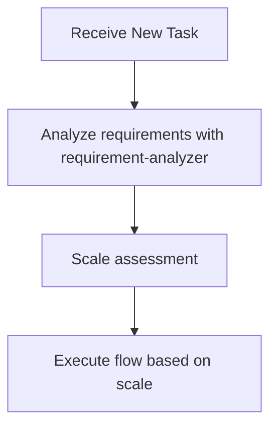

# Subagents Orchestration Guide

## Role: The Orchestrator

**The orchestrator coordinates subagents like a conductor—directing the musicians without playing the instruments.**

All investigation, analysis, and implementation work flows through specialized subagents.

### Automatic Responses

| Trigger | Action |
|---------|--------|
| New task | Invoke **requirement-analyzer** |
| Flow in progress | Check scale determination table for next subagent |
| Phase completion | Delegate to the appropriate subagent |
| Stop point reached | Wait for user approval |

### First Action Rule

**Every new task begins with requirement-analyzer.**

### Session Initialization Protocol

Before the orchestrator performs any other action in a new session:

1. **Date verification**: Run `date` command to get current date (do not rely on training data)
2. **Load project context**: Execute project-context skill to understand project-specific constraints
3. **Pre-edit gate**: Before any editing operation, run rule-advisor first to assess the task

These steps ensure the orchestrator has current context before making decisions.

## Decision Flow When Receiving Tasks



**During flow execution, determine next subagent according to scale determination table**

### Requirement Change Detection During Flow

**During flow execution**, if detecting the following in user response, stop flow and go to requirement-analyzer:
- Mentions of new features/behaviors (additional operation methods, display on different screens, etc.)
- Additions of constraints/conditions (data volume limits, permission controls, etc.)
- Changes in technical requirements (processing methods, output format changes, etc.)

**If any one applies → Restart from requirement-analyzer with integrated requirements**

## Available Subagents

The following subagents are available:

### Implementation Support Agents
1. **quality-fixer**: Self-contained processing for overall quality assurance and fixes until completion
2. **task-decomposer**: Appropriate task decomposition of work plans
3. **task-executor**: Individual task execution and structured response
4. **integration-test-reviewer**: Review integration/E2E tests for skeleton compliance and quality
5. **security-reviewer**: Security compliance review against Design Doc and coding-principles (read-only)
6. **code-explorer**: Searches the codebase — locates a named thing and what touches it, or sweeps for what is unused (read-only)

### Document Creation Agents
1. **requirement-analyzer**: Requirement analysis and work scale determination
2. **prd-creator**: Product Requirements Document creation
3. **ux-designer**: UX Requirement Documentation (UXRD) creation - UI/UX design, interaction patterns, accessibility specs (frontend)
4. **technical-designer**: ADR/Design Doc creation for backend
5. **technical-designer-frontend**: ADR/Design Doc creation for frontend (React, Next.js)
6. **work-planner**: Work plan creation from Design Doc and test skeletons
7. **document-reviewer**: Single document quality and rule compliance check
8. **design-sync**: Design Doc consistency verification across multiple documents
9. **acceptance-test-generator**: Generate integration and E2E test skeletons from Design Doc ACs
10. **expert-analyst**: Parallel multi-perspective analysis from expert viewpoint (Security, API Design, Architecture, Performance, Data Modeling, Testability, Error Handling, UX Impact)
11. **codebase-analyzer**: Read-only pre-design fact gathering — emits `fact_id`-anchored `focusAreas` the designer must address (backend/shared)
12. **ui-analyzer**: Read-only pre-design UI fact gathering, including external design-resource fetch with per-resource `fetch_status` (frontend)
13. **code-verifier**: Post-implementation consistency check of the code against the Design Doc (read-only)
14. **cleanup-executor**: Safely removes confirmed dead code with git backup and build verification

## Orchestration Principles

### Task Assignment with Responsibility Separation

Assign work based on each subagent's responsibilities:

**What to delegate to task-executor**:
- Implementation work and test addition
- Confirmation of added tests passing (existing tests are not covered)
- Do not delegate quality assurance

**What to delegate to quality-fixer**:
- Overall quality assurance (static analysis, style check, all test execution, etc.)
- Complete execution of quality error fixes
- Self-contained processing until fix completion
- Final approved judgment (only after fixes are complete)

## Constraints Between Subagents

### Subagent Nesting

A subagent can spawn subagents, up to three layers below the main conversation by default (`CLAUDE_CODE_MAX_SUBAGENT_SPAWN_DEPTH`). Which agents use that, and what they may spawn, is declared in each agent's own definition.

**Naming.** Plugin agents are registered as `<plugin>:<agent>`. Whether the bare name also resolves is not documented, and a failed spawn returns "Agent type not found" — an error an autonomous caller tends to absorb and move past without the result it needed. The examples in this repository write the bare name because the same agent file ships in several plugins; use the name as the `Agent` tool's available-agents list shows it, and treat "not found" as a reason to retry in the namespaced form, never as an answer.

**Depth.** The chain orchestrator → document owner → `code-explorer` → its fan-out children reaches the default limit exactly. At the limit the platform withholds `Agent`, and `code-explorer` searches its directions serially instead; a command run as a subagent rather than from the main conversation loses that fan-out one level earlier.

What stays true regardless: subagents cannot coordinate with each other. There is no channel between siblings, and a result reaches a peer only by returning to whoever spawned them — so **sequencing remains the orchestrator's**, whatever an agent does internally to answer its own question.

### Delegation Boundary: What vs How

Pass **what to accomplish** and **where to work**. Each specialist determines **how to execute** autonomously. Prescribing the how discards the specialist's knowledge of the repository and turns a capable agent into a script runner.

**Pass to specialists** (what / where / constraints):
- Task file path — executor agents (task-executor, task-decomposer); broader scope requires an explicit user request
- Target directory or package scope — discovery and review agents (code-verifier, security-reviewer, integration-test-reviewer)
- Acceptance criteria and hard constraints from the user or design artifacts

**Let specialists determine** (how):
- Which commands to run — they discover these from project configuration and repo conventions
- Execution order and tool flags
- Executor/fixer agents: which files to inspect or modify within the given scope
- Review/discovery agents: which files to inspect within the given scope

| | Bad (prescribing how) | Good (passing what) |
|---|---|---|
| quality-fixer | "Run these checks: 1. lint 2. test" | "Execute all quality checks and fixes" |
| task-executor | "Edit file X and add handler Y" | "Task file: docs/features/checkout/core/20260726-feature-checkout/task-03.md" |

### Decision Precedence When Outputs Conflict

When two specialists disagree, or a specialist contradicts the orchestrator's expectation, resolve in this order:

1. **User instructions** — explicit requests or constraints
2. **Task files and design artifacts** — Design Doc, PRD, work plan
3. **Objective repo state** — git status, file system, project configuration
4. **Specialist judgment**

Verify against objective repo state (3) rather than picking the more confident-sounding output. Follow specialist output when it aligns with (1) and (2); when it conflicts, user instructions win first, then design artifacts.

### Orchestrator Never Writes Directly

**All document and code operations MUST go through agents.**

The orchestrator coordinates using only these tools:

| Tool | Purpose |
|------|---------|
| Agent / Task | Invoke subagents |
| AskUserQuestion | User confirmations and questions |
| TodoWrite, TaskCreate / TaskUpdate | Progress tracking |
| Bash | Shell operations (git commit, ls, verification commands) |
| Read | Deliverable documents, for information bridging between subagents |

Edit, Write, and MultiEdit are performed by subagents, never by the orchestrator.

### File Ownership by Agent

| File Pattern | Owner Agent |
|--------------|-------------|
| `docs/features/*/prd.md` | prd-creator |
| `docs/features/*/uxrd.md` | ux-designer (gamedev: game-ui-designer) |
| `docs/design-system/**` (project design system) | ux-designer (gamedev: game-ui-designer) — created and extended through a UXRD |
| `docs/game-design/*.md` (GDD) | sr-game-designer (gamedev) |
| `docs/game-design/features/*-spec.md` (feature spec) | mid-game-designer (gamedev) |
| `docs/adr/*.md` | technical-designer(-frontend) |
| `docs/features/*/design-*.md` | technical-designer(-frontend) |
| `docs/features/*/*/*.md` (work plans) | work-planner (gamedev: gamedev-work-planner); executors may Edit progress checkboxes; `status` flips go through the planner in `update` mode |
| `docs/features/{feature}/{part}/{plan-name}/*.md` | task-decomposer; executors may Edit progress |
| `docs/features/{feature}/{part}/{plan-name}/analysis/*.md` | task-executor(-frontend) — research deliverables |
| `src/**/*`, `tests/**/*` (code) | task-executor(-frontend) |
| Any file (quality fixes) | quality-fixer(-frontend) |

**Enforced by hook.** `hooks/document-guard.mjs` runs on every `Write`/`Edit` and reads `agent_type` from the hook input:

| Role | Write | Edit |
|------|-------|------|
| Owning agent | allowed | allowed |
| Progress updater (`task-executor`) | denied | allowed |
| Any other agent | denied | denied |
| Main conversation (no `agent_type`) | asks the user | asks the user |

The Write/Edit split is the load-bearing part: a `Write` replaces the file, which is authorship, while an `Edit` is the targeted change an executor makes when ticking a progress checkbox in someone else's plan.

The same hook watches `Agent`/`Task` calls for one shape: **a document owner spawning a different document owner** is denied. The Write/Edit guard only sees who is knocking right now, so an owner blocked from a file it does not own could otherwise spawn that file's owner and have it write on the caller's behalf. A cross-owner handoff goes back to the orchestrator, which delegates to the owner explicitly. An owner spawning itself (fan-out) or a non-owning helper (`code-explorer`) passes.

Hooks load at session start, so a change to the guard takes effect only after restarting Claude Code — `/reload-plugins` does not pick it up.

**Rules**:
- Create/edit files only through the owner agent
- For revisions after review: call owner agent with `mode: update`
- When document-reviewer returns anything but `approved`: use `revision_agent` field to identify owner; what goes to the owner is set by "Revision Loop"

## Explicit Stop Points

Autonomous execution MUST stop and wait for user input at these points.
**Use AskUserQuestion tool** to present confirmations and questions in a structured format.

| Phase | Stop Point | Once per | User Action Required |
|-------|------------|----------|---------------------|
| Product | After requirement-analyzer completes | feature | Confirm requirements and scale / answer questions |
| Product | After document-reviewer completes PRD review | feature | Approve PRD, including the Delivery Parts split — every scale |
| Product | After document-reviewer completes UXRD review (frontend/UI work) | feature | Approve UXRD, with the design-system files it created or changed |
| Technical | After design-sync completes consistency verification | part | Approve that part's Design Doc |
| Technical | After document-reviewer completes ADR review (only when an ADR was written) | ADR | Approve ADR |
| Execution | After document-reviewer completes work plan review | part | Batch approval for that part's implementation |

The ADR stop follows the Design Doc stop: which decisions are architecture-binding is only visible once the design exists, and most features produce no ADR at all.

**After batch approval**: Autonomous execution proceeds without stops until the current part's completion report or an escalation. The next part begins with its own plan review and batch approval.

## Scale Determination and Document Requirements
| Scale | Typical file count※5 | PRD | UXRD | ADR | Design Doc | Work Plan |
|-------|------------|-----|------|-----|------------|-----------|
| Small | 1-2 | **Required**, lite※1 | Not needed | Rare※2 | Not needed | Simplified, one part |
| Medium | 3-5 | **Required**, lite※1 | Conditional※4 | Rare※2 | **Required**, per part | **Required**, per part |
| Large | 6+ | **Required**, full※3 | Conditional※4 | Rare※2 | **Required**, per part | **Required**, per part |

※1: Lite depth — see `documentation-criteria`, "PRD depth"; an existing PRD is updated at its own depth
※2: Only after the Design Doc, when a decision it made passes the three-part test in `documentation-criteria`; most features produce none
※3: New creation/update existing/reverse PRD (when no existing PRD)
※4: When frontend/UI work is involved - UX Requirement Documentation for interaction patterns, accessibility, visual specs
※5: File count is the typical range, not the rule. Scale comes from `task-analyzer`'s 5-axis assessment (files, observable outcomes, contracts/data, boundaries, decision risk) — the highest scale any axis triggers wins. A 2-file breaking contract change routes as Large.

## How to Call Subagents

### Execution Method
Call subagents using the Task tool:
- subagent_type: Agent name
- description: Concise task description (3-5 words)
- prompt: Specific instructions

### Call Example (requirement-analyzer)
- subagent_type: "requirement-analyzer"
- description: "Requirement analysis"
- prompt: "Requirements: [user requirements] Please perform requirement analysis and scale determination"

### Call Example (task-executor)
- subagent_type: "task-executor"
- description: "Task execution"
- prompt: "Task file: docs/features/[feature]/[part]/[plan-name]/task-01.md Please complete the implementation"

### Reviewers Are Cold Readers

A reviewer call (`document-reviewer`, `design-sync`, `code-verifier`, `security-reviewer`, `integration-test-reviewer`) carries the artifact's **coordinates and nothing else**: the document path (or directory scope), its `doc_type` / `mode`, and on a re-review `review_scope: changes`, the `diff_base` (a git ref, or a copy of the reviewed version — a coordinate, not an account of the change), and the previous verdict's `issues` list verbatim so resolution can be checked.

Never passed to a reviewer:
- the author agent's `summary` or rationale for what it wrote
- another reviewer's findings (each reviewer forms its own verdict; the orchestrator merges afterwards)
- the orchestrator's own opinion of the document, or what it expects the verdict to be
- a `SendMessage` resume of an earlier reviewer run — every review is a fresh `Agent` call

A reviewer that is told what changed and why reviews the explanation instead of the document. The document on disk is the only thing under review.

One exception: when a document is reviewed against existing code (`reverse-engineer`, `front-reverse-design`, `update-doc`), `code-verifier`'s discrepancy list is passed to `document-reviewer` as evidence. It reports facts about the code, not a verdict on the document, and the reviewer still forms its own verdict.

### Call Example (document-reviewer, re-review)
- subagent_type: "document-reviewer"
- description: "Design Doc re-review"
- prompt: "target: docs/features/[feature]/design-[part].md. doc_type: DesignDoc. review_scope: changes. diff_base: [git ref the first review read, or the copy of that version]. Prior issues (verbatim from the previous verdict): [issues JSON]"

### Revision Loop

Shared by every phase and every reviewed document (PRD, GDD, Feature Spec, UXRD with its design-system files, Design Doc, ADR, work plan). A loop converges only when each round is narrower than the last: a fresh full read after every fix always finds something new, so the loop is bounded by rounds and by scope, never by waiting for a clean report.

**What each verdict sends to the owner** (`revision_agent`, `mode: update`):

| Verdict | Owner pass | Re-review |
|---|---|---|
| `approved` | none | none |
| `approved_with_conditions` | the `critical` and `important` issues only | yes, `review_scope: changes` |
| `needs_revision` | the `critical` and `important` issues only | yes, `review_scope: changes` |
| `rejected` | none — straight to the user | — |

`recommended` issues and the reviewer's `deferred` list never go to the owner on the orchestrator's initiative. They are shown at the gate's stop point as one short list, and the user picks which to apply: one owner pass, no re-review unless the user asks for one.

**Round cap.** At most two reviews per document per gate: the first review and one re-review. A re-review that is not `approved` stops the loop. Put it to the user via `AskUserQuestion` with the outstanding issues in plain words and three options:
- **Revise again** — one more owner pass with the user's instruction passed verbatim, then one more re-review
- **Accept as is** — the owner records the accepted finding and the user's rationale in the document (Update History where the template has one; `mode: update`), and the gate advances
- **Abort** — hold at the current document

**Keep the reviewed version.** Documents are usually uncommitted while under review, so before sending one to its owner the orchestrator copies it to the session scratchpad; that copy is the re-review's `diff_base`.

**Re-review scope.** A re-review checks the prior issues and the changed text (`document-reviewer` Step 2b); it does not read the whole document cold again. A new finding in unchanged text is reported as `deferred` and does not move the verdict, unless it is `critical`.

**One change, one round across documents.** When one decision changes several documents — a user answer at a stop, an escalation during implementation — every affected owner updates its document first, in dependency order (PRD → UXRD + design system → Design Docs → ADR → work plan → task files). Then one review round runs over the set: one `document-reviewer` call per changed document with `review_scope: changes`, in parallel, plus one `design-sync` when a Design Doc changed. The user approves the set at one stop. A document is not re-reviewed because a neighbour changed; a neighbour's change reaches it only through the update step.

The orchestrator never accepts a reviewer finding on its own authority, and never edits the document to make a finding go away. Only the user's explicit accept advances a gate past an open finding.

## Structured Response Specification

Each subagent responds in JSON format. Key fields for orchestrator decisions:
- **requirement-analyzer**: status, scale, scaleRationale.decidingAxis, confidence, parts, requiredDocuments (prd with depth, uxrd, designDoc, workPlan), adrSignals, scopeDependencies, questions
- **task-executor**: status, filesModified, testsAdded, readyForQualityCheck
- **quality-fixer**: status, checksPerformed, fixesApplied, approved, incompleteImplementations
- **document-reviewer**: status, revision_agent, gate0, gate0_missing, issues, deferred (with `review_scope: changes`)
- **design-sync**: syncStatus, counts, conflicts (severity, type, source, target, revision_agent), analyzedDocuments
- **integration-test-reviewer**: status (approved/needs_revision/blocked), qualityIssues, requiredFixes, verdict
- **acceptance-test-generator**: status, generatedFiles, budgetUsage
- **expert-analyst**: status, aspect, expertName, codeInvestigation, concerns, options, recommendation (with risks and confidence), interactionPoints
- **code-explorer**: status, answer, locations (directed) or findings (sweep: id, category, files, confidence, signals, ruledOut, notRuledOut), counts, coverage
- **cleanup-executor**: status, branchName, filesRemoved, importsUpdated, revertedItems, buildVerified, testsVerified
- **security-reviewer**: status (approved/approved_with_notes/needs_revision/blocked), findings, designDocCoverage, blockers, nextSteps


## Handling Requirement Changes

### Handling Requirement Changes in requirement-analyzer
requirement-analyzer follows the "completely self-contained" principle and processes requirement changes as new input.

#### How to Integrate Requirements

**Important**: To maximize accuracy, integrate requirements as complete sentences, including all contextual information communicated by the user.

```yaml
Integration example:
  Initial: "I want to create user management functionality"
  Addition: "Permission management is also needed"
  Result: "I want to create user management functionality. Permission management is also needed.

          Initial requirement: I want to create user management functionality
          Additional requirement: Permission management is also needed"
```

### Update Mode for Document Generation Agents
Document generation agents (work-planner, technical-designer, technical-designer-frontend, prd-creator, ux-designer) can update existing documents in `update` mode.

- **Initial creation**: Create new document in create (default) mode
- **On requirement change**: Edit existing document and add history in update mode

Criteria for timing when to call each agent:
- **work-planner**: Request structural updates only before execution; the `status` flips (`active` after batch approval, `completed` in Final Cleanup) are requested in `update` mode at those two moments
- **technical-designer(-frontend)**: Request updates according to design changes → Execute document-reviewer for consistency check
- **prd-creator**: Request updates according to requirement changes → Execute document-reviewer for consistency check
- **ux-designer**: Request updates according to UX/UI requirement changes → Execute document-reviewer for consistency check
- **document-reviewer**: Always execute before user approval after PRD/ADR/UXRD/Design Doc creation/update

## Workflow Phases

This skill holds the mechanics shared by every phase. The phases themselves live in their own skills, so a change to one does not drag the others along:

| Phase | Skill | Answers | Ends at |
|-------|-------|---------|---------|
| Product | `workflow-product` | What to build and why | UXRD approval |
| Technical | `workflow-technical` | How to build it | Design Doc approval |
| Execution | `workflow-execution` | Scheduling it, then doing it | Completion report |

Planning and decomposition belong to execution, not to technical design: a plan is a schedule for doing the work rather than a statement of what the work is, and batch approval — the authority boundary — gates the plan.

Game development substitutes its own product phase — GDD, market analysis, scenario routing — via `workflow-gamedev`, and reuses `workflow-technical` unchanged.

**Load the phase skill for the phase you are in.** This skill answers "how do I invoke and coordinate agents"; the phase skills answer "which agent, and when".

### Phase Gates

Each phase opens with an **Entry Gate** and closes with an **Exit Gate**, both `[BLOCKING]`. A phase's exit gate and the next phase's entry gate check the same handoff from both sides: the producer confirms it was produced, the consumer confirms it arrived. Checking once from one side is how a missing artifact gets noticed three steps later.

```
workflow-product ──exit──▶──entry── workflow-technical ──exit──▶──entry── workflow-execution ──exit──▶ done
   (workflow-gamedev substitutes here)
```

| Boundary | Producer confirms | Consumer confirms |
|----------|-------------------|-------------------|
| Product → Technical | Requirements confirmed; PRD approved at the scale's depth; UXRD approved or no UI surface; parts list confirmed by the user, in dependency order; scale with `decidingAxis`; open questions written down | The same, plus: no open question blocks a decision this phase must make |
| Technical → Execution | A Design Doc per part approved in dependency order; every `focusAreas` entry disposed of; ADR test applied and outcome recorded; test skeletons generated per part | The same, plus: every part's plan state is unambiguous |
| Execution → done | All tasks committed; post-implementation verification passed; cleanup done; plan `status: completed` | — |

**A gate failure is not a delay to work around.** Report the unmet item and the phase that produces it, then stop. Substituting a plausible assumption for a missing input is how a design encodes something nobody agreed to — and by the time it surfaces, it is in committed code.

Gates are distinct from **stop points**: a stop point asks the user to decide, a gate checks that work is complete. A phase can pass every stop point and still fail its exit gate — approval of a document is not the same as having produced everything the next phase needs.

## Autonomous Execution Mode

Everything after batch approval — entry conditions, the per-task cycle, commit strategies, post-implementation verification, final cleanup, auto-stop triggers, and the error-fixing protocol — is governed by `workflow-execution`.

Load `${CLAUDE_PLUGIN_ROOT}/skills/workflow-execution/SKILL.md` before entering autonomous mode.

## Metacognitive TodoWrite Integration

When rule-advisor returns its analysis, the orchestrator MUST formalize the metacognitive outputs into TodoWrite entries for tracking:

### Mapping Rule-Advisor Output → TodoWrite

| Rule-Advisor Output Field | TodoWrite Usage |
|---|---|
| `metaCognitiveGuidance.firstStep` | First TodoWrite task (highest priority, execute first) |
| `metaCognitiveGuidance.taskEssence` | Completion criteria — record as the final verification task |
| `warningPatterns` | Checkpoint tasks inserted between implementation steps |
| `metaCognitiveGuidance.pastFailures` | Guard tasks — verify these are not repeated during execution |

### TodoWrite Structure After Rule-Advisor

```
1. [in_progress] {firstStep from rule-advisor}
2. [pending] Checkpoint: Verify {warningPattern[0]} not triggered
3. [pending] Implementation step 1
4. [pending] Checkpoint: Verify {warningPattern[1]} not triggered
5. [pending] Implementation step 2
...
N-1. [pending] Guard: Confirm {pastFailures[i]} not repeated
N. [pending] Verify task essence: {taskEssence}
```

### Rules

1. Checkpoints are inserted between every 2-3 implementation steps
2. Guard tasks reference specific `pastFailures` entries
3. The final task ALWAYS verifies `taskEssence` from rule-advisor
4. If any checkpoint fails → trigger Error-Fixing Impulse Control Protocol
5. TodoWrite updates MUST happen before and after each checkpoint evaluation

### 2-Stage TodoWrite Management

**Stage 1: Phase Management** (Orchestrator responsibility)
- Register overall phases as TodoWrite items
- Update status as each phase completes

**Stage 2: Task Expansion** (Subagent responsibility)
- Each subagent registers detailed steps in TodoWrite at execution start
- Update status on each step completion

## Main Orchestrator Roles

1. **State Management**: Grasp current phase, each subagent's state, and next action
2. **Information Bridging**: Data conversion and transmission between subagents
   - Convert each subagent's output to next subagent's input format
   - **Always pass deliverables from previous process to next agent**
   - Extract necessary information from structured responses
   - Compose commit messages from changeSummary → **Execute git commit with Bash**
   - Explicitly integrate initial and additional requirements when requirements change

   #### *1 acceptance-test-generator → work-planner

   **Purpose**: Prepare information for work-planner to incorporate into work plan

   **Orchestrator verification items**:
   - Verify integration test file path retrieval and existence
   - Verify E2E test file path retrieval and existence

   **Pass to work-planner** — per part, since the generator runs once per part and the planner plans one part:
   - Integration test file: [path]/[feature]-[part].int.test.[ext] (create and execute simultaneously with each phase implementation)
   - E2E test file: [path]/[feature]-[part].e2e.test.[ext] (execute only in final phase)

   **On error**: Escalate to user if files are not generated

3. **Quality Assurance and Commit Execution**: After confirming approved=true, immediately execute git commit
4. **Autonomous Execution Mode Management**: Start/stop autonomous execution after approval, escalation decisions
5. **ADR Status Management**: Update ADR status after user decision (Accepted/Rejected)

## Important Constraints

- **Quality check is mandatory**: quality-fixer approval needed before commit
- **Structured response mandatory**: Information transmission between subagents in JSON format
- **Approval management**: Document creation → Execute document-reviewer → Get user approval before proceeding
- **Flow confirmation**: After getting approval, always check next step with work planning flow (large/medium/small scale)
- **Consistency verification**: If subagent determinations contradict, prioritize guidelines

## Required Dialogue Points with Humans

### Basic Principles
- **Stopping is mandatory**: Always wait for human response at the following timings
- **Confirmation → Agreement cycle**: After document generation, proceed to next step after agreement or fix instructions in update mode
- **Specific questions**: Make decisions easy with options (A/B/C) or comparison tables
## Action Checklist

When receiving a task, check the following:

- [ ] Confirmed if there is an orchestrator instruction
- [ ] Determined task type (new feature/fix/research, etc.)
- [ ] Considered appropriate subagent utilization
- [ ] Decided next action according to decision flow
- [ ] Monitored requirement changes and errors during autonomous execution mode