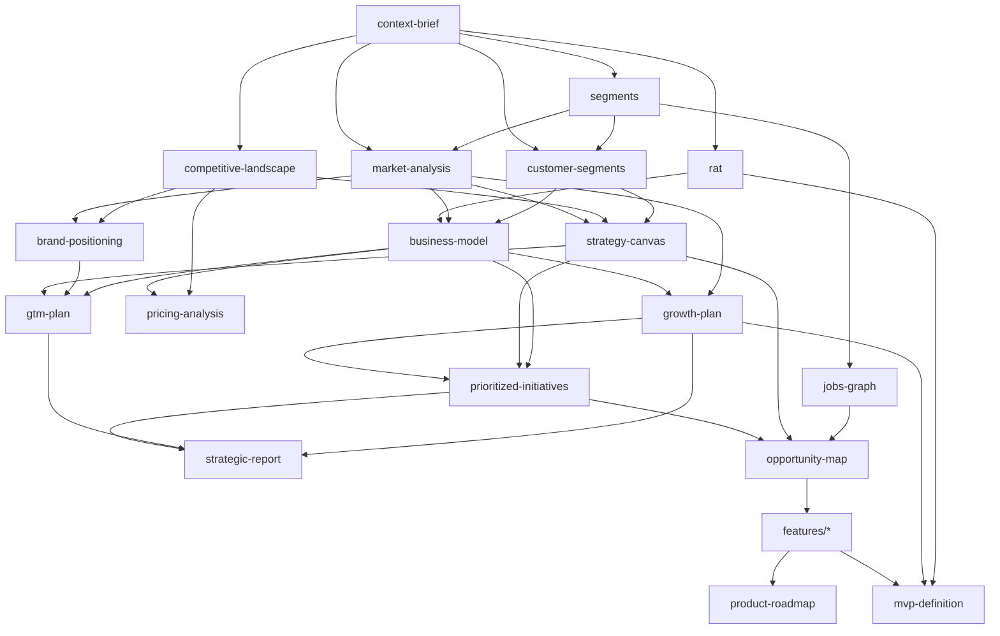

# Strategy Documentation Criteria

## Templates

- **[context-brief-template.md](${CLAUDE_PLUGIN_ROOT}/skills/strategy-documentation-criteria/references/context-brief-template.md)** — Business context extraction
- **[market-analysis-template.md](${CLAUDE_PLUGIN_ROOT}/skills/strategy-documentation-criteria/references/market-analysis-template.md)** — TAM/SAM/SOM market sizing
- **[competitive-landscape-template.md](${CLAUDE_PLUGIN_ROOT}/skills/strategy-documentation-criteria/references/competitive-landscape-template.md)** — Competitor profiles, Porter's, SWOT/TOWS
- **[customer-segments-template.md](${CLAUDE_PLUGIN_ROOT}/skills/strategy-documentation-criteria/references/customer-segments-template.md)** — Segment analysis and attractiveness scoring
- **[strategy-canvas-template.md](${CLAUDE_PLUGIN_ROOT}/skills/strategy-documentation-criteria/references/strategy-canvas-template.md)** — Blue Ocean, Ansoff/BCG, Value Proposition
- **[brand-positioning-template.md](${CLAUDE_PLUGIN_ROOT}/skills/strategy-documentation-criteria/references/brand-positioning-template.md)** — Perceptual maps, positioning statement
- **[business-model-template.md](${CLAUDE_PLUGIN_ROOT}/skills/strategy-documentation-criteria/references/business-model-template.md)** — Lean Canvas / BMC, unit economics
- **[gtm-plan-template.md](${CLAUDE_PLUGIN_ROOT}/skills/strategy-documentation-criteria/references/gtm-plan-template.md)** — ICP, messaging, channels, launch plan
- **[pricing-analysis-template.md](${CLAUDE_PLUGIN_ROOT}/skills/strategy-documentation-criteria/references/pricing-analysis-template.md)** — Value-based pricing, tier structure
- **[growth-plan-template.md](${CLAUDE_PLUGIN_ROOT}/skills/strategy-documentation-criteria/references/growth-plan-template.md)** — AARRR funnel, experiments, 90-day plan
- **[prioritized-initiatives-template.md](${CLAUDE_PLUGIN_ROOT}/skills/strategy-documentation-criteria/references/prioritized-initiatives-template.md)** — ICE/RICE scored master list
- **[strategic-report-template.md](${CLAUDE_PLUGIN_ROOT}/skills/strategy-documentation-criteria/references/strategic-report-template.md)** — Unified McKinsey-grade final report
- **[rat-template.md](${CLAUDE_PLUGIN_ROOT}/skills/strategy-documentation-criteria/references/rat-template.md)** — RAT analysis with P×I risk scoring
- **[segments-template.md](${CLAUDE_PLUGIN_ROOT}/skills/strategy-documentation-criteria/references/segments-template.md)** — AJTBD segment discovery (B2B/B2C)
- **[jobs-graph-template.md](${CLAUDE_PLUGIN_ROOT}/skills/strategy-documentation-criteria/references/jobs-graph-template.md)** — Jobs graph below Core Job level
- **[opportunity-map-template.md](${CLAUDE_PLUGIN_ROOT}/skills/strategy-documentation-criteria/references/opportunity-map-template.md)** — Opportunity Solution Tree (outcomes → opportunities → solutions → tests)
- **[feature-spec-template.md](${CLAUDE_PLUGIN_ROOT}/skills/strategy-documentation-criteria/references/feature-spec-template.md)** — Individual feature specification (Shape Up pitch + cross-references)
- **[product-roadmap-template.md](${CLAUDE_PLUGIN_ROOT}/skills/strategy-documentation-criteria/references/product-roadmap-template.md)** — Now/Next/Later product roadmap with feature links
- **[mvp-definition-template.md](${CLAUDE_PLUGIN_ROOT}/skills/strategy-documentation-criteria/references/mvp-definition-template.md)** — MVP scope, MoSCoW, success metrics, validation plan

## Creation Decision Matrix

| Analysis Scope | Required Documents | Creation Order |
|---------------|-------------------|----------------|
| Full Analysis (`/strategy-report`) | Every document in Storage Locations except the landing page | Phases 1–7 of `strategy-orchestration-guide`: Context → AJTBD (3) → Market (3) → Strategy (2) + Model (1) → GTM (2) + Growth (2) → Report (1) → Product Plan (3+N) |
| Market Only (`/analyze-market`) | Context + Market + Competitive + Segments | Context → Market (3) |
| Strategy Only (`/strategy-canvas`) | Context + [Market] → Strategy Canvas + Brand Positioning | Prereqs → Strategy (2) |
| Model Only (`/business-model`) | Context + [Market] → Business Model | Prereqs → Model (1) |
| GTM Only (`/gtm-plan`) | Context + [Market] → GTM Plan + Pricing | Prereqs → GTM (2) |
| Growth Only (`/growth-audit`) | Context + [Market] → Growth Plan + Priorities | Prereqs → Growth (2) |
| Competitive Only (`/competitive-map`) | Context → Competitive Landscape | Context → Competitive (1) |
| Pricing Only (`/pricing-strategy`) | Context + [Market] → Pricing Analysis | Prereqs → Pricing (1) |
| Prioritize Only (`/prioritize`) | [All existing docs] → Prioritized Initiatives | Collect → Prioritize (1) |
| RAT Only (`/rat`) | Context → RAT | Context → RAT (1) |
| B2B Segments (`/b2b-segments`) | Context → Segments | Context → Segments (1) |
| B2C Segments (`/b2c-segments`) | Context → Segments | Context → Segments (1) |
| Jobs Graph (`/jobs-graph`) | Context + [Segments] → Jobs Graph | Prereqs → Jobs (1) |
| Landing (`/landing`) | Context + Segments + [Jobs Graph] → Landing | Prereqs → Landing (1) |
| Product Plan (`/product-plan`) | All strategy docs → Opportunity Map + Features + Roadmap + MVP | Strategy → Product Plan (3+N) |

`[brackets]` = optional but recommended prerequisite

## Document Dependency Chain

## Storage Locations

This table is the one list of strategy files, their owners, and the commands that write them; the orchestration guide and commands cite it.

| Document | Path | Owner Agent | Command | Template |
|----------|------|-------------|---------|----------|
| Context Brief | `docs/strategy/context-brief.md` | context-analyzer | every flow | [context-brief-template.md](${CLAUDE_PLUGIN_ROOT}/skills/strategy-documentation-criteria/references/context-brief-template.md) |
| Market Analysis | `docs/strategy/market-analysis.md` | market-analyst | `/analyze-market` | [market-analysis-template.md](${CLAUDE_PLUGIN_ROOT}/skills/strategy-documentation-criteria/references/market-analysis-template.md) |
| Competitive Landscape | `docs/strategy/competitive-landscape.md` | market-analyst | `/competitive-map`, `/analyze-market` | [competitive-landscape-template.md](${CLAUDE_PLUGIN_ROOT}/skills/strategy-documentation-criteria/references/competitive-landscape-template.md) |
| Customer Segments | `docs/strategy/customer-segments.md` | market-analyst | `/analyze-market` | [customer-segments-template.md](${CLAUDE_PLUGIN_ROOT}/skills/strategy-documentation-criteria/references/customer-segments-template.md) |
| Strategy Canvas | `docs/strategy/strategy-canvas.md` | strategy-architect | `/strategy-canvas` | [strategy-canvas-template.md](${CLAUDE_PLUGIN_ROOT}/skills/strategy-documentation-criteria/references/strategy-canvas-template.md) |
| Brand Positioning | `docs/strategy/brand-positioning.md` | strategy-architect | `/strategy-canvas` | [brand-positioning-template.md](${CLAUDE_PLUGIN_ROOT}/skills/strategy-documentation-criteria/references/brand-positioning-template.md) |
| Business Model | `docs/strategy/business-model.md` | business-modeler | `/business-model` | [business-model-template.md](${CLAUDE_PLUGIN_ROOT}/skills/strategy-documentation-criteria/references/business-model-template.md) |
| GTM Plan | `docs/strategy/gtm-plan.md` | gtm-planner | `/gtm-plan` | [gtm-plan-template.md](${CLAUDE_PLUGIN_ROOT}/skills/strategy-documentation-criteria/references/gtm-plan-template.md) |
| Pricing Analysis | `docs/strategy/pricing-analysis.md` | gtm-planner | `/pricing-strategy`, `/gtm-plan` | [pricing-analysis-template.md](${CLAUDE_PLUGIN_ROOT}/skills/strategy-documentation-criteria/references/pricing-analysis-template.md) |
| Growth Plan | `docs/strategy/growth-plan.md` | growth-strategist | `/growth-audit` | [growth-plan-template.md](${CLAUDE_PLUGIN_ROOT}/skills/strategy-documentation-criteria/references/growth-plan-template.md) |
| Prioritized Initiatives | `docs/strategy/prioritized-initiatives.md` | growth-strategist | `/prioritize`, `/growth-audit` | [prioritized-initiatives-template.md](${CLAUDE_PLUGIN_ROOT}/skills/strategy-documentation-criteria/references/prioritized-initiatives-template.md) |
| Strategic Report | `docs/strategy/strategic-report.md` | report-compiler | `/strategy-report` | [strategic-report-template.md](${CLAUDE_PLUGIN_ROOT}/skills/strategy-documentation-criteria/references/strategic-report-template.md) |
| RAT Analysis | `docs/strategy/rat.md` | product-analyst | `/rat` | [rat-template.md](${CLAUDE_PLUGIN_ROOT}/skills/strategy-documentation-criteria/references/rat-template.md) |
| AJTBD Segments | `docs/strategy/segments.md` | product-analyst | `/b2b-segments`, `/b2c-segments` | [segments-template.md](${CLAUDE_PLUGIN_ROOT}/skills/strategy-documentation-criteria/references/segments-template.md) |
| Jobs Graph | `docs/strategy/jobs-graph.md` | product-analyst | `/jobs-graph` | [jobs-graph-template.md](${CLAUDE_PLUGIN_ROOT}/skills/strategy-documentation-criteria/references/jobs-graph-template.md) |
| Opportunity Map | `docs/strategy/opportunity-map.md` | product-planner | `/product-plan` | [opportunity-map-template.md](${CLAUDE_PLUGIN_ROOT}/skills/strategy-documentation-criteria/references/opportunity-map-template.md) |
| Feature Specs | `docs/strategy/features/feature-NNN-[slug].md` | product-planner | `/product-plan` | [feature-spec-template.md](${CLAUDE_PLUGIN_ROOT}/skills/strategy-documentation-criteria/references/feature-spec-template.md) |
| Product Roadmap | `docs/strategy/product-roadmap.md` | product-planner | `/product-plan` | [product-roadmap-template.md](${CLAUDE_PLUGIN_ROOT}/skills/strategy-documentation-criteria/references/product-roadmap-template.md) |
| MVP Definition | `docs/strategy/mvp-definition.md` | product-planner | `/product-plan` | [mvp-definition-template.md](${CLAUDE_PLUGIN_ROOT}/skills/strategy-documentation-criteria/references/mvp-definition-template.md) |
| Landing Page | `docs/strategy/landing.md` | product-analyst | `/landing` | none — the structure is in the `/landing` command |

## Quality Standards (All Documents)

### Pyramid Principle and MECE (Mandatory)

1. **Governing thought first** — the document, and each section that draws a conclusion, opens with the answer.
2. **Action titles** — the document's governing-thought heading and each heading that states a conclusion are complete sentences stating the point. A template's structural headings ("Market Size & Growth", "Risk Assessment") stay as labels; the conclusion goes in the first sentence under them.
3. **Titles test** — the action titles and the Overview, read alone, carry the argument.
4. **MECE grouping** — categories at each level do not overlap (Mutually Exclusive) and together cover the space (Collectively Exhaustive).

### Writing for the Reader (Mandatory)

The reader is cold: they know the business in general but not this analysis, and they read it without the analyst or the conversation behind it — a founder, an investor, a teammate months later. **Lean** means the document says fewer things and says each one fully; the same content squeezed into shorthand is not lean, it is unreadable.

- **Overview first.** Under the governing-thought heading, three to five plain sentences: the answer, what it means for the business, the biggest risk or uncertainty. A reader who stops there can say what the document concludes.
- **Sentences, not telegrams.** Write sentences with a subject and a verb, one idea each. A chain of noun phrases joined by commas, slashes, and arrows is shorthand only the analyst can expand. A table cell is one phrase a newcomer can read; reasoning goes under the table.
- **Short units.** A paragraph has at most four sentences; a list item is one statement.
- **Terms.** A framework, metric, or abbreviation (TAM, ICE, WSJF, LTV:CAC) is explained in a few words where it first appears.
- **For people first.** The document is prose, lists, tables, and diagrams. No YAML blocks, and a checkbox list only where the reader will tick it (a launch checklist); a table that only maps one set of IDs onto another goes to the appendix.
- **Delete, don't stub.** A section that does not apply to this business is deleted — no "N/A", no placeholder. Template guidance in `[brackets]` is replaced, never copied.
- **One language.** The whole document, headings included, is in the language the user writes in; framework names stay as terms.

### Source Credibility (Mandatory)

Every number a conclusion or recommendation rests on carries its tier; background figures need none.

| Tier | Description | Usage |
|------|-------------|-------|
| **Tier 1** | Official filings, confirmed metrics, direct data; TrustMRR (Stripe-verified revenue) for software and subscription products | Hard numbers, quotes |
| **Tier 2** | Industry reports, analyst estimates, reliable press | Market context, trends |
| **Tier 3** | AI estimates, pattern extrapolation, analogies | Gap-fill with disclosure |

**Rule**: Never present Tier 3 as Tier 1. Always disclose estimation methodology.

### Actionability (Mandatory)

The document's conclusion says **So what?** (why this matters) and **Now what?** (specific next actions) — once, at the end or in its recommendations section, never repeated after every section. **Confidence** (High / Medium / Low) is stated once, in the header where the template puts it.

### Tone

| Do | Don't |
|----|-------|
| "Base case: $2M ARR by Month 18 (Tier 3 estimate, Medium confidence)" | "Revenue could potentially grow significantly" |
| "This approach carries three risks" | "There are some concerns" |
| "The data shows 73% preference" | "Most people seem to prefer" |
| Use numbers, percentages, timelines | Use "many", "some", "soon", "significant" |

### Pre-Submission Checklist

- The governing thought comes first; headings that state a conclusion are action titles
- Categories are MECE
- Numbers a conclusion rests on carry a tier; no Tier 3 presented as Tier 1; estimation methods disclosed
- The conclusion says So what / Now what once; confidence is stated once
- Recommendations are specific and actionable; assumptions are stated
- Writing for the Reader holds; no placeholders, and a section that does not apply is deleted
- Strategic report only: an aggregated risk assessment with mitigations, and next steps with owners and timelines
